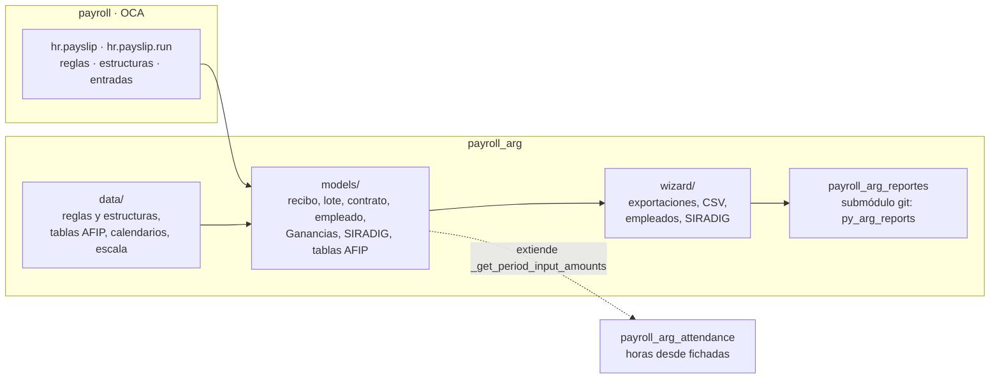
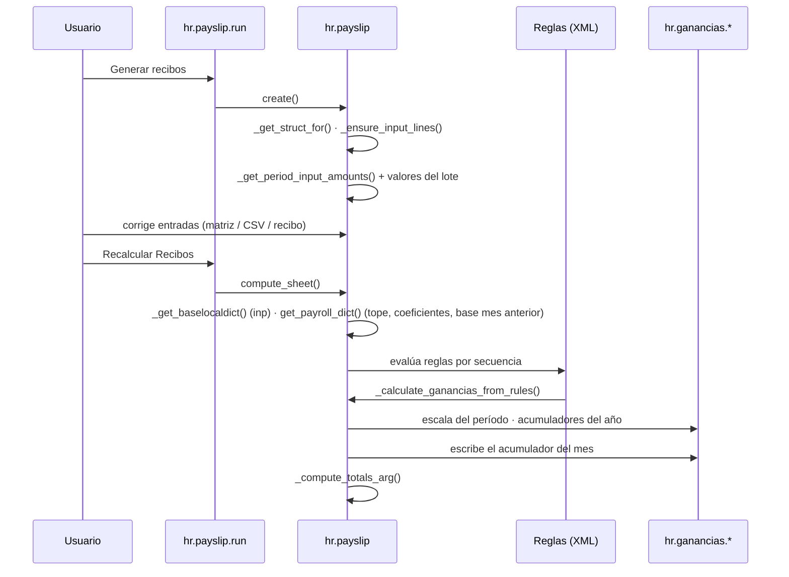

# Arquitectura

## Piezas

- **`payroll` (OCA)** pone el motor: recibos, lotes, reglas Python, categorías, entradas y el cálculo
  (`compute_sheet`).
- **`payroll_arg`** pone:
  - los datos legales: reglas, estructuras, tablas AFIP, alícuotas en la compañía y la escala de
    Ganancias;
  - la carga automática de novedades;
  - Ganancias y SIRADIG;
  - el armado de los datos de cada exportación.
- **`py_arg_reports`** (submódulo `payroll_arg_reportes`, repositorio aparte) genera los archivos:
  recibo PDF, TXT del LSD y del F.931, Galicia y Santander. Recibe diccionarios; no conoce Odoo.
  `__init__.py` agrega el submódulo al `sys.path`.
- **`payroll_arg_attendance`** reemplaza las horas del calendario por las fichadas.

## Mapa de archivos

| Archivo | Qué tiene |
|---|---|
| `models/hr_payslip.py` | Recibo: totales argentinos, carga de novedades, fuentes del período (calendario, licencias, feriados), parámetros de las reglas, Ganancias, datos para F.931 / LSD / recibo PDF. |
| `models/hr_payslip_run.py` | Lote: tipo de liquidación, matriz de novedades, acciones masivas, armado del LSD, F.931 y recibos. |
| `models/hr_payslip_run_novelty.py` | Valores de novedad fijados para todo el lote. |
| `models/hr_payslip_input.py` | Entradas del recibo con empleado y lote guardados (para la matriz). |
| `models/hr_contract.py` | Contrato (`hr.version`): tipo de salario, convenio, categoría, códigos AFIP, coherencia tipo de salario ↔ estructura ↔ calendario; estructura y calendario por defecto. |
| `models/hr_employee.py` | Empleado: CUIL, legajo, CBU, obra social, cargas de Ganancias, F.572. |
| `models/hr_salary_rule.py` | Regla: tipo de concepto AFIP, código LSD, unidad. |
| `models/hr_ganancias.py` | Escala de Ganancias y acumuladores mensuales. |
| `models/hr_siradig.py` | F.572 importado y su aplicación a la ficha. |
| `models/res_company.py` | Alícuotas, coeficientes, detracción, tope, ART, seguros, último pago de SS. |
| `models/afip_base.py` | Tablas AFIP y de convenio (CCT, categorías, obras sociales, códigos F.931). |
| `models/hr_leave.py` | Validación de licencias aprobadas relajada para recálculos. |
| `data/salary_structure_jornal_data.xml` | Categorías, **todas las reglas salariales**, entradas y las 8 estructuras. `noupdate="0"`: se reescriben al actualizar. |
| `data/afip_data.xml` | Tablas AFIP, CCT UOM y Comercio, categorías, calendarios de 44 y 40 hs, tipo de licencia de vacaciones. |
| `data/ganancias_scale_2026.xml` | Escala de Ganancias de ejemplo (`noupdate`; ver C5). |
| `data/sample_jornal_batch_data.xml` | Datos de demostración (empleado y lotes). |
| `wizard/payroll_arg_export_wizard.py` | Exportaciones (llama a `py_arg_reports`). |
| `wizard/hr_payslip_run_input_import.py` | Importación de novedades por CSV. |
| `wizard/payroll_arg_employee_wizard.py` | Importación / exportación de empleados (Excel / CSV). |
| `wizard/hr_siradig_import_wizard.py` | Importación de F.572 (XML / ZIP). |
| `migrations/19.0.2.0.0/` | Limpia asistencias duplicadas de los calendarios. |
| `tools/documentacion.py` | Verificador de docstrings y generador de `docs/referencia.md`. |
| `tests/` | Recibos reales, novedades y documentación. |

## Cómo se calcula un recibo

## Decisiones de diseño

- **Las entradas son la única fuente de novedades.** Antes había campos de novedades en el recibo y en
  el lote; se borraron en 19.0.2.0.0. Las reglas sólo leen `inp()`. Así una novedad se ve, se edita
  y se importa en un solo lugar, y recalcular nunca pisa datos.
- **Todo recibo tiene todas las entradas de su estructura** (`_ensure_input_lines()`), aunque se haya
  creado por importación o por código: la matriz del lote necesita una celda por empleado y código.
- **El tipo de concepto AFIP manda en los totales**, no la categoría: una regla nueva cae en el total
  correcto con sólo elegir su tipo.
- **Medio tope por quincena** y **contribuciones de jornalizados sobre el mes anterior**: replican los
  recibos reales del cliente. Ver C9 y C20 en la [revisión](revision.md).
- **Estructura por tipo de lote:** Vacaciones, SAC y Final usan su estructura aunque el contrato tenga
  otra, y un mismo lote sirve para jornalizados y mensualizados.
- **Alícuotas en la compañía, no en las reglas:** cambiar una alícuota no requiere tocar el XML. Pero no
  tienen fecha de vigencia (T8).
- **4 decimales en el importe de la línea:** `30 × (sueldo / 30)` da el sueldo exacto.
- **Totales sumando importes sin redondear** y redondeando al final, como el recibo oficial.

## Puntos de extensión

| Método | Para qué | Quién lo extiende |
|---|---|---|
| `hr.payslip._get_period_input_amounts()` | Agregar o reemplazar novedades automáticas. | `payroll_arg_attendance` (horas desde fichadas). |
| `hr.payslip.get_payroll_dict()` | Nuevos parámetros para las reglas (`payroll.<clave>`). | — |
| `hr.payslip._get_struct_for()` | Elegir la estructura según contrato y lote. | — |
| `hr.payslip._to_recibo_dict()`, `_get_afip_info_f931()`, `_get_conceptos_liquidados_lsd()` | Datos de cada exportación. | — |

## Dependencias externas

| Dependencia | Para qué |
|---|---|
| `payroll` (OCA) | Motor de nómina. |
| `hr_holidays`, `resource` | Licencias, calendarios y feriados. |
| `web_widget_x2many_2d_matrix` (OCA) | Matriz de novedades del lote. |
| `py_arg_reports` (submódulo) | Recibos PDF, LSD, F.931, bancos. |
| `openpyxl`, `xlsxwriter` (Python) | Importación / exportación de empleados. |
| `hr_attendance` (sólo `payroll_arg_attendance`) | Fichadas y motor de horas extras. |
