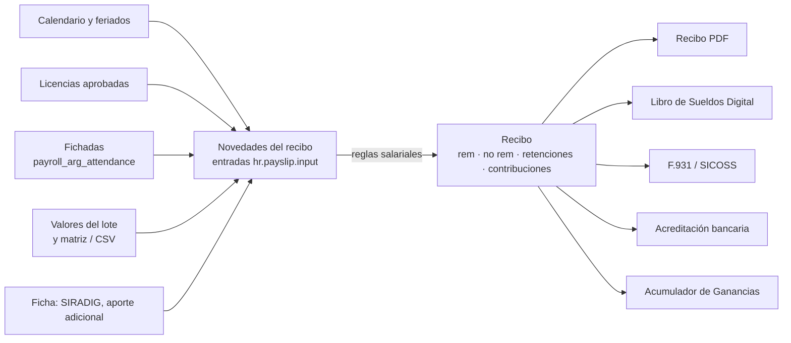

# Conceptos

## La idea central

Una liquidación argentina convierte las **novedades** del período (horas, feriados, vacaciones,
premios, viandas…) en un **recibo de sueldo**:

- **Haberes remunerativos.** Pagan aportes y contribuciones.
- **Haberes no remunerativos.** No pagan jubilación; sí Obra Social y sindicato si son de convenio.
- **Retenciones al trabajador.** Aportes de ley, cuota sindical, Ganancias, descuentos.
- **Contribuciones del empleador.** No afectan el neto; son costo.

Con los recibos de cada lote se generan los archivos para ARCA (Libro de Sueldos Digital, F.931) y para
el banco.

## Jornalizados y mensualizados

| | Jornalizado (UOM) | Mensualizado |
|---|---|---|
| Básico del contrato (`wage`) | **Valor hora** | Sueldo mensual |
| Liquidación | Quincenal: 1° Quincena (1–15) y 2° Quincena (16–fin) | Mensual |
| Estructura | `JORNAL_QUINC_ARG` | `MENSUAL_ARG` |
| Calendario | Jornal Fábrica UOM, 44 hs (lun–jue 9 hs, vie 8 hs) | Administración, 40 hs |
| Básico del recibo | Horas normales × valor hora (88 hs por quincena) | 30 días × sueldo / 30, menos días de vacaciones |
| Feriados | Se pagan aparte (horas × valor hora) | Incluidos en el sueldo |
| Horas extras | Al 50% y al 100% | No están en la estructura |
| Vacaciones | Días × valor hora × horas por día × 1,20 | Días × sueldo / 25 |
| Base de contribuciones | Remunerativo del último mes declarado | Remunerativo del recibo |

El tipo de salario del contrato decide todo lo demás: al cambiarlo se ajustan estructura, calendario y
periodicidad, y una restricción impide combinar un jornalizado con una estructura mensual.

## Quién usa el módulo

| Rol | Dónde trabaja | Qué hace |
|---|---|---|
| Liquidador de sueldos (grupo de nómina) | *Nómina › Lotes* y *Nómina Argentina* | Arma los lotes, carga novedades, calcula, revisa, confirma y exporta. |
| Responsable de RR. HH. | Empleados, Contratos, Ausencias, Asistencias | Mantiene fichas, contratos, categorías, licencias aprobadas y fichadas. |
| Administrador | *Nómina Argentina › Configuración* y la compañía | Alícuotas, tope, detracción, coeficientes, seguros, escala de Ganancias, convenios y categorías. |

## Glosario

| Término | Significado | En Odoo |
|---|---|---|
| **Lote** (liquidación) | Conjunto de recibos de un período y un tipo: 1° / 2° Quincena, Mensual, Vacaciones, SAC, Liquidación Final, Ajustes. | `hr.payslip.run`, campo `tipo_liquidacion`. |
| **Recibo** | Liquidación de un empleado en un lote. | `hr.payslip`. |
| **Novedad / entrada** | Dato variable del período que leen las reglas (horas, días, importes). Una por código y recibo. | `hr.payslip.input`; código en `hr.rule.input`. Las reglas la leen con `inp('HS_NORM')`. |
| **Valor del lote** | Novedad con el mismo valor para todo el lote (precio de vianda, presentismo). | `hr.payslip.run.novelty`. |
| **Regla salarial** | Fórmula de un concepto del recibo. | `hr.salary.rule` (Python en `amount_python_compute`). |
| **Estructura** | Conjunto de reglas de un tipo de liquidación y salario. | `hr.payroll.structure`. Ver [referencia](referencia.md#estructuras-salariales). |
| **Tipo de concepto AFIP** | 1 remunerativo, 2 no remunerativo, 3 retención, 4 contribución / total. Define en qué total cae la línea. | `hr.salary.rule.tipo_concepto`. |
| **Remunerativo** | Retribución por el trabajo: paga aportes y contribuciones (Art. 103 LCT, Art. 6 Ley 24.241). | Categoría `REM`. |
| **No remunerativo** | Sumas que la ley o el convenio excluyen de la remuneración: acuerdos salariales, indemnizaciones. | Categoría `NOREM`. |
| **Aportes** | Retenciones de Seguridad Social al trabajador: jubilación 11%, Ley 19.032 3%, Obra Social 3%. | Categoría `DED`. |
| **Contribuciones** | A cargo del empleador: SIPA, INSSJP, AAFF, FNE (18% en total), Obra Social 6%, ART, seguros. | Categoría `COMP`. |
| **Tope imponible** | Base máxima para los aportes del trabajador (Art. 9 Ley 24.241). En quincenas, la mitad. | `res.company.tope_imponible_max_retencion`; por recibo `tope_imponible_retenciones`. |
| **Detracción** | Importe mensual que se resta de la base de contribuciones (Ley 27.541; $7.003,68). | `res.company.detraccion_sipa`. |
| **Coeficientes de contribución** | Multiplican las contribuciones: 1 = alícuota plena; los recibos de referencia usan 0,10 (SS) y 0,15 (OS). | `coef_contrib_ss` / `coef_contrib_os` de la compañía y del lote. |
| **Antigüedad** | Adicional del 1% por año (CCT UOM) sobre las horas pagadas a valor hora. | Regla `ADIC_ANTIG`, `payslip.antiguedad_anios`. |
| **SAC** (aguinaldo) | 50% de la mayor remuneración mensual del semestre (Ley 23.041), en junio y diciembre. | Lote SAC, reglas `SAC_*`, novedades `SAC_BASE` y `SAC_DIAS`. |
| **Ganancias 4ta categoría** | Impuesto que el empleador retiene por el método acumulativo (RG 4003). | Regla `RET_GANANCIAS`, escalas `hr.ganancias.scale`, acumuladores. |
| **SIRADIG / F.572** | Declaración del trabajador de cargas de familia y deducciones para Ganancias. | `hr.siradig.f572`. |
| **LSD** | Libro de Sueldos Digital (ARCA): archivo TXT con cada liquidación y sus conceptos. | Exportación del lote; código de concepto en `hr.salary.rule.afip_code`. |
| **F.931 / SICOSS** | Declaración jurada mensual de aportes y contribuciones. | Exportación del lote (ver E1 en la [revisión](revision.md#e1)). |
| **CCT** | Convenio colectivo (UOM 260/75, Comercio 130/75): cuota sindical y divisor de vacaciones. | `afip.cct`. |
| **Categoría** | Categoría profesional del convenio con su básico. | `afip.labor.category`. |
| **Contrato** | En Odoo 19, versión del empleado con sueldo, estructura y datos AFIP. | `hr.version` (el código lo llama `contract`). |

## Un ejemplo completo

2° Quincena de agosto de 2026 (16 al 31), operario UOM, valor hora $6.675,34, 6 años de antigüedad. Es
uno de los recibos de referencia que reproduce `tests/test_recibos_referencia.py`.

**Novedades:** `HS_NORM` 88, `FERIADO` 9 (lunes 17/08), `PRESENTISMO` 394.150,85, `GRATIF_NO_REM` 30.000,
`COMPENS_NO_REM` 70.000. Base de contribuciones (remunerativo del último mes declarado) 3.945.490,21.

| Concepto | Cálculo | Importe |
|---|---|---|
| Básico horas | 88 × 6.675,34 | 587.429,92 |
| Feriado | 9 × 6.675,34 | 60.078,06 |
| Antigüedad | 6% × (88 + 9) × 6.675,34 = 6% × 647.507,98 | 38.850,48 |
| Presentismo | novedad | 394.150,85 |
| **Remunerativo** | | **1.080.509,31** |
| Gratificación y compensación no rem. | novedades | 100.000,00 |
| Jubilación | 11% × 1.080.509,31 (no llega al medio tope de 2.125.000) | −118.856,02 |
| Ley 19.032 | 3% × 1.080.509,31 | −32.415,28 |
| Obra Social | 3% × (1.080.509,31 + 100.000) | −35.415,28 |
| Cuota sindical | 2,5% × 1.180.509,31 | −29.512,73 |
| Seguro de vida UOM | cuota fija (2° quincena) | −8.045,65 |
| **Neto** | 1.080.509,31 + 100.000 − 224.244,97 | **956.264,34** |
| Contribución ART | 5,82% × 3.945.490,21 | 229.627,53 |
| Contribución SIPA | 10,77% × (3.945.490,21 − 7.003,68) × 0,10 | 42.417,50 |
| Contribución Obra Social | 6% × 3.945.490,21 × 0,15 | 35.509,41 |
| Contribución AAFF | 4,70% × 3.945.490,21 × 0,10 | 18.543,80 |
| Contribución FNE | 0,94% × 3.945.490,21 × 0,10 | 3.708,76 |
| Contribución Ley 19.032 | 1,59% × (3.945.490,21 − 7.003,68) × 0,10 | 6.262,19 |
| SCVO y seguro de vida UOM | cuotas fijas | 424,62 + 8.045,65 |
| **Contribuciones** | | **344.539,47** |

El detalle de cada fórmula está en [Liquidación](liquidacion.md). La forma de llegar a este recibo (lote,
novedades, cálculo, exportación), en [Flujos](flujos.md).
