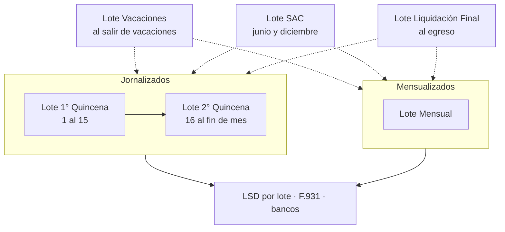
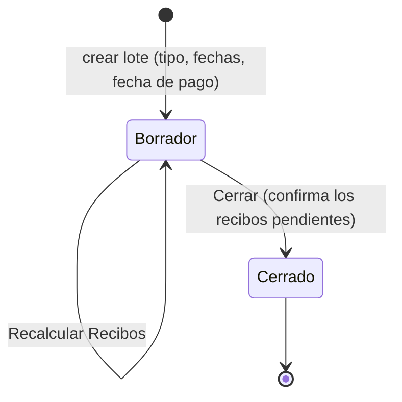

# Flujos

## El mes de un liquidador

| Tipo de lote | N° de liquidación sugerido | Estructura | Novedades automáticas |
|---|---|---|---|
| 1° Quincena | 1 | jornales | horas y feriados (jornal), vacaciones, SIRADIG |
| 2° Quincena | 2 | jornales | ídem + aporte adicional SS |
| Quincenal | — | jornales | ídem 1° Quincena |
| Mensual | 1 | mensuales | vacaciones, SIRADIG, aporte adicional SS |
| Vacaciones | — | de vacaciones según el tipo de salario | vacaciones, SIRADIG |
| SAC | — | de SAC según el tipo de salario | SIRADIG |
| Liquidación Final | — | final según el tipo de salario | horas y feriados (jornal), vacaciones, SIRADIG |
| Ajustes | — | la del contrato | horas y feriados (jornal), vacaciones, SIRADIG |

En los lotes de Vacaciones, SAC y Final el lote no tiene estructura: cada recibo toma la variante
jornal o mensual según su contrato (`hr.payslip._get_struct_for()`), así que un mismo lote sirve para
los dos tipos de salario.

## Un lote, paso a paso

1. **Crear el lote.** Elegir el tipo de liquidación (sugiere estructura y número de liquidación),
   las fechas y la fecha de pago (por defecto, el fin del período). Los coeficientes de contribución
   vienen de la compañía y se pueden cambiar para el lote.
2. **Generar los recibos** con el asistente de empleados de `payroll`. Cada recibo nace con todas las
   entradas de su estructura y su valor automático (ver [Novedades](#novedades)).
3. **Cargar novedades:** valores del lote, matriz, CSV o el recibo.
4. **Recalcular Recibos.** Si falta contrato, estructura o básico, el cálculo frena con el nombre del
   empleado.
5. **Revisar** en la pestaña *Recibos* (antigüedad, totales, neto) y en cada recibo (líneas,
   contribuciones, Ganancias, tope aplicado).
6. **Exportar:** recibos PDF, LSD, F.931 y bancos, con *Exportar Reportes Argentina*. Las exportaciones
   toman los recibos **en espera o hechos**.
7. **Cerrar** el lote: confirma los recibos que queden en borrador o en espera.

Un recibo confirmado (*hecho*) ya no se recalcula ni se le cargan novedades. Cambiar las fechas del lote
cambia las de sus recibos editables, pero no recarga las novedades (T3): usar *Recargar Novedades del
Período*.

## Novedades

Cada recibo tiene **una entrada por código** de su estructura. Es lo único que leen las reglas. El
cálculo nunca las modifica, así que recalcular no pierde datos.

**De dónde sale el valor de una entrada.** Al crear el recibo, al cambiar su estructura o con
*Recargar*, en este orden de precedencia:

1. **Valor del lote** (*Novedades › Valores del Lote*). Mismo valor para todos. *Recargar* no lo
   pisa; *Aplicar a todos* lo vuelve a escribir en todos los recibos editables.
2. **Valor del período** (`hr.payslip._get_period_input_amounts()`):
   - `HS_NORM`: horas del calendario menos vacaciones. Con `payroll_arg_attendance` y fichadas en el
     período, horas fichadas (y `HS_EXT50` / `HS_EXT100` del motor de horas extras).
   - `FERIADO`: feriados en días laborables × horas por día.
   - `VAC_DIAS`: días corridos de vacaciones aprobadas en el período.
   - `DED_SIRADIG`: deducción mensual del F.572 de la ficha.
   - `APORTE_ADIC_SS`: monto de la ficha (2° Quincena y Mensual).
3. **0** para el resto (premios, viandas, no remunerativos, SAC, indemnizaciones).

**Dónde se editan.**
- **Matriz del lote** (*Novedades*): una fila por empleado y una columna por código, en dos tablas:
  horas / días / cantidades e importes ($).
- **CSV** (*Importar Novedades (CSV)*): una fila por empleado (legajo, CUIL o nombre) y una columna
  por código. Ver [Operación](operacion.md#importar-novedades).
- **Recibo**, pestaña de entradas.

*Recargar Novedades del Período* (en el lote o en el recibo) vuelve a leer calendario, licencias,
fichadas y ficha, y **pisa** esos códigos aunque se hayan corregido a mano (U3).

## Vacaciones

1. Cargar y aprobar la licencia de tipo *Licencia por Vacaciones (LCT)*.
2. **Si se pagan al salir** (enero, febrero): lote *Vacaciones* con las fechas de la licencia. Cada
   recibo trae `VAC_DIAS` y paga las vacaciones.
3. En la quincena o el mes que contiene esos días, `VAC_DIAS` descuenta horas (jornal) o días
   (mensual). **Hoy también las vuelve a pagar (C1):** poner `VACACIONES` en 0 a mano, o no usar el
   lote de vacaciones y pagarlas dentro de la quincena o el mes.

## SAC

1. Lote *SAC* (junio / diciembre) con las fechas del semestre.
2. Cargar `SAC_BASE` (mayor remuneración mensual del semestre) y, si no trabajó el semestre completo,
   `SAC_DIAS`. Sin `SAC_BASE` se estima con el básico (C10).
3. Calcular, revisar, exportar y cerrar.

## Liquidación final

1. Lote *Liquidación Final* con el período del último mes o quincena trabajada.
2. Cargar `HS_NORM` o los días, `VAC_NO_GOZ`, `SAC_BASE` / `SAC_DIAS` e importes de indemnización
   (`INDEM_ANTIG`, `INDEM_PREAV`, `INTEG_MES`) calculados aparte.
3. Revisar especialmente Obra Social y sindicato sobre indemnizaciones (C7) y aportes sobre vacaciones
   no gozadas (C22).

## Ganancias

1. Cada año / semestre: cargar la escala y deducciones de ARCA (*Ganancias: Escalas*). Sin escala
   vigente no se retiene.
2. Importar los F.572 (*Importar SIRADIG AFIP*) con *Aplicar inmediatamente*, o aplicarlos desde cada
   declaración. Eso actualiza en la ficha cónyuge, hijos y deducción mensual.
3. Los recibos que se creen o recarguen después traen `DED_SIRADIG` con la deducción mensual.
4. Cada cálculo de un recibo actualiza el acumulador del mes (*Ganancias: Acumuladores*). Ver C2 antes
   de liquidar quincenas.

## Exportaciones

| Exportación | Desde | Toma | Notas |
|---|---|---|---|
| Recibo PDF | Recibo o lote | Recibos en espera o hechos | Diseño 1 a 4; el 4 muestra base y contribuciones. |
| Libro de Sueldos Digital | Lote | Ídem; valida CUIL, contrato y cálculo | Una liquidación por lote. Ver E2. |
| F.931 (SICOSS) | Lote | Ídem | Por lote, no por mes. Ver E1. |
| Galicia (Excel) / Santander (TXT) | Lote | Recibos con neto positivo | Ver E3. |
