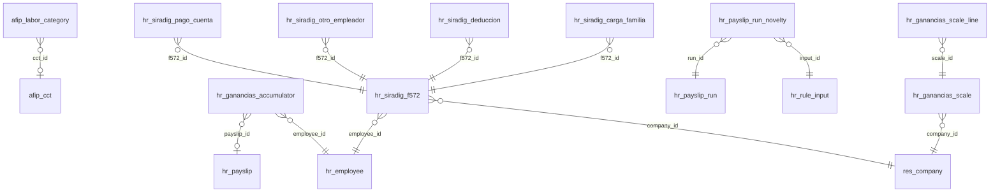

# Referencia generada del módulo Nómina Argentina

> Archivo generado por `tools/documentacion.py`: no editar a mano. Cómo regenerarlo: ver el encabezado de ese archivo.

## Estructuras salariales

Reglas de cada estructura en orden de cálculo (secuencia). Tipo = *Tipo de Concepto AFIP* (define en qué total cae la línea). Las fórmulas completas están en [Reglas salariales](#reglas-salariales); la explicación de negocio, en [Liquidación](liquidacion.md).

### `FINAL_JORNAL_ARG` — Liquidación Final Jornal (Argentina)

| Sec. | Código | Concepto | Categoría | Tipo | Cód. LSD | Unidad |
|---|---|---|---|---|---|---|
| 10 | `BASIC_HORAS` | Básico Horas Trabajadas | REM | Rem. | 110000 | H |
| 18 | `VAC_NO_GOZ_JORNAL` | Vacaciones No Gozadas Jornal (Art. 156 LCT) | REM | Rem. | 150001 | D |
| 25 | `SAC_PROP_JORNAL` | SAC Proporcional al Egreso Jornal | REM | Rem. | 120003 | D |
| 50 | `INDEM_ANTIGUEDAD` | Indemnización por Antigüedad (Art. 245 LCT) | NOREM | No rem. | 210000 | $ |
| 51 | `INDEM_PREAVISO` | Indemnización Sustitutiva Preaviso (Art. 232 LCT) | NOREM | No rem. | 210001 | $ |
| 52 | `INTEG_MES_DESPIDO` | Integración Mes de Despido (Art. 233 LCT) | NOREM | No rem. | 210002 | $ |
| 100 | `GROSS` | Total Bruto Remunerativo | GROSS | Contrib. / total | — | D |
| 110 | `RET_JUB` | Jubilación (SIPA 11%) | DED | Retención | 810001 | % |
| 120 | `RET_INSSJP` | Ley 19.032 (INSSJyP 3%) | DED | Retención | 810002 | % |
| 130 | `RET_OS` | Obra Social (3%) | DED | Retención | 810003 | % |
| 140 | `RET_SIND` | Cuota Sindical | DED | Retención | 820001 | % |
| 150 | `RET_GANANCIAS` | Retención Ganancias (4ta Cat.) | DED | Retención | 810004 | $ |
| 200 | `NET` | Sueldo Neto a Cobrar | NET | Contrib. / total | — | D |
| 300 | `COMP_ART` | Contribución ART | COMP | Contrib. / total | — | D |
| 310 | `COMP_JUB` | Contribución Jubilación | COMP | Contrib. / total | — | D |
| 320 | `COMP_OS` | Contribución Obra Social | COMP | Contrib. / total | — | D |
| 330 | `COMP_AAFF` | Contribución AAFF | COMP | Contrib. / total | — | D |
| 340 | `COMP_FNE` | Contribución FNE | COMP | Contrib. / total | — | D |
| 350 | `COMP_INSSJP` | Contribución Ley 19032 | COMP | Contrib. / total | — | D |

### `FINAL_MENSUAL_ARG` — Liquidación Final Mensual (Argentina)

| Sec. | Código | Concepto | Categoría | Tipo | Cód. LSD | Unidad |
|---|---|---|---|---|---|---|
| 10 | `BASIC_MENSUAL` | Sueldo Básico Mensual | REM | Rem. | 110000 | D |
| 18 | `VAC_NO_GOZ_MENS` | Vacaciones No Gozadas (Art. 156 LCT) | REM | Rem. | 150001 | D |
| 25 | `SAC_PROP_MENS` | SAC Proporcional al Egreso | REM | Rem. | 120003 | D |
| 50 | `INDEM_ANTIGUEDAD` | Indemnización por Antigüedad (Art. 245 LCT) | NOREM | No rem. | 210000 | $ |
| 51 | `INDEM_PREAVISO` | Indemnización Sustitutiva Preaviso (Art. 232 LCT) | NOREM | No rem. | 210001 | $ |
| 52 | `INTEG_MES_DESPIDO` | Integración Mes de Despido (Art. 233 LCT) | NOREM | No rem. | 210002 | $ |
| 100 | `GROSS` | Total Bruto Remunerativo | GROSS | Contrib. / total | — | D |
| 110 | `RET_JUB` | Jubilación (SIPA 11%) | DED | Retención | 810001 | % |
| 120 | `RET_INSSJP` | Ley 19.032 (INSSJyP 3%) | DED | Retención | 810002 | % |
| 130 | `RET_OS` | Obra Social (3%) | DED | Retención | 810003 | % |
| 140 | `RET_SIND` | Cuota Sindical | DED | Retención | 820001 | % |
| 150 | `RET_GANANCIAS` | Retención Ganancias (4ta Cat.) | DED | Retención | 810004 | $ |
| 200 | `NET` | Sueldo Neto a Cobrar | NET | Contrib. / total | — | D |
| 300 | `COMP_ART` | Contribución ART | COMP | Contrib. / total | — | D |
| 310 | `COMP_JUB` | Contribución Jubilación | COMP | Contrib. / total | — | D |
| 320 | `COMP_OS` | Contribución Obra Social | COMP | Contrib. / total | — | D |
| 330 | `COMP_AAFF` | Contribución AAFF | COMP | Contrib. / total | — | D |
| 340 | `COMP_FNE` | Contribución FNE | COMP | Contrib. / total | — | D |
| 350 | `COMP_INSSJP` | Contribución Ley 19032 | COMP | Contrib. / total | — | D |

### `JORNAL_QUINC_ARG` — Jornales Quincenales (Argentina)

| Sec. | Código | Concepto | Categoría | Tipo | Cód. LSD | Unidad |
|---|---|---|---|---|---|---|
| 10 | `BASIC_HORAS` | Básico Horas Trabajadas | REM | Rem. | 110000 | H |
| 12 | `FERIADO` | Feriados | REM | Rem. | 130000 | H |
| 20 | `ADIC_ANTIG` | Adicional Antigüedad | REM | Rem. | 120000 | % |
| 20 | `HS_EXT_50` | Horas Extras 50% | REM | Rem. | 130000 | H |
| 25 | `OBJETIVOS` | Objetivos | REM | Rem. | 0 | H |
| 26 | `PREMIO_PROD` | Premio Producción | REM | Rem. | 0 | U |
| 27 | `PRESENTISMO` | Presentismo | REM | Rem. | 0 | U |
| 28 | `PORTITULO` | Portítulo | REM | Rem. | 0 | U |
| 30 | `HS_EXT_100` | Horas Extras 100% | REM | Rem. | 130001 | H |
| 40 | `ASIG_NO_REM` | Asignación No Remunerativa (UOM) | NOREM | No rem. | 550000 | $ |
| 40 | `VACACIONES` | Adelanto Vacaciones | REM | Rem. | 150000 | D |
| 41 | `GRATIF_NO_REM` | Gratif. Extraordinaria No Rem. | NOREM | No rem. | 550000 | $ |
| 42 | `COMPENS_NO_REM` | Compens. Extraord. NR | NOREM | No rem. | 550000 | $ |
| 100 | `GROSS` | Total Bruto Remunerativo | GROSS | Contrib. / total | — | D |
| 110 | `RET_JUB` | Jubilación (SIPA 11%) | DED | Retención | 810001 | % |
| 120 | `RET_INSSJP` | Ley 19.032 (INSSJyP 3%) | DED | Retención | 810002 | % |
| 130 | `RET_OS` | Obra Social (3%) | DED | Retención | 810003 | % |
| 140 | `RET_SIND` | Cuota Sindical | DED | Retención | 820001 | % |
| 150 | `RET_GANANCIAS` | Retención Ganancias (4ta Cat.) | DED | Retención | 810004 | $ |
| 155 | `RET_UOM_VIDA` | Seg. de Vida UOM | DED | Retención | 820002 | $ |
| 160 | `APORTE_ADIC_SS` | Aporte Adicional Seg. Social | DED | Retención | 810005 | $ |
| 170 | `DESC_VIANDAS` | Descuento Viandas | DED | Retención | 990000 | U |
| 200 | `NET` | Sueldo Neto a Cobrar | NET | Contrib. / total | — | D |
| 300 | `COMP_ART` | Contribución ART | COMP | Contrib. / total | — | D |
| 310 | `COMP_JUB` | Contribución Jubilación | COMP | Contrib. / total | — | D |
| 320 | `COMP_OS` | Contribución Obra Social | COMP | Contrib. / total | — | D |
| 330 | `COMP_AAFF` | Contribución AAFF | COMP | Contrib. / total | — | D |
| 340 | `COMP_FNE` | Contribución FNE | COMP | Contrib. / total | — | D |
| 350 | `COMP_INSSJP` | Contribución Ley 19032 | COMP | Contrib. / total | — | D |
| 360 | `COMP_SCVO` | Contribución SCVO Seg de vida | COMP | Contrib. / total | — | D |
| 370 | `COMP_UOM_VIDA` | Contr.Seguro de Vida UOM | COMP | Contrib. / total | — | D |

### `MENSUAL_ARG` — Mensuales Administración / Planta (Argentina)

| Sec. | Código | Concepto | Categoría | Tipo | Cód. LSD | Unidad |
|---|---|---|---|---|---|---|
| 10 | `BASIC_MENSUAL` | Sueldo Básico Mensual | REM | Rem. | 110000 | D |
| 15 | `VACACIONES_MENSUAL` | Licencia por Vacaciones | REM | Rem. | 150000 | D |
| 20 | `ADIC_ANTIG` | Adicional Antigüedad | REM | Rem. | 120000 | % |
| 40 | `ASIG_NO_REM` | Asignación No Remunerativa (UOM) | NOREM | No rem. | 550000 | $ |
| 41 | `GRATIF_NO_REM` | Gratif. Extraordinaria No Rem. | NOREM | No rem. | 550000 | $ |
| 42 | `COMPENS_NO_REM` | Compens. Extraord. NR | NOREM | No rem. | 550000 | $ |
| 100 | `GROSS` | Total Bruto Remunerativo | GROSS | Contrib. / total | — | D |
| 110 | `RET_JUB` | Jubilación (SIPA 11%) | DED | Retención | 810001 | % |
| 120 | `RET_INSSJP` | Ley 19.032 (INSSJyP 3%) | DED | Retención | 810002 | % |
| 130 | `RET_OS` | Obra Social (3%) | DED | Retención | 810003 | % |
| 140 | `RET_SIND` | Cuota Sindical | DED | Retención | 820001 | % |
| 150 | `RET_GANANCIAS` | Retención Ganancias (4ta Cat.) | DED | Retención | 810004 | $ |
| 155 | `RET_UOM_VIDA` | Seg. de Vida UOM | DED | Retención | 820002 | $ |
| 200 | `NET` | Sueldo Neto a Cobrar | NET | Contrib. / total | — | D |
| 300 | `COMP_ART` | Contribución ART | COMP | Contrib. / total | — | D |
| 310 | `COMP_JUB` | Contribución Jubilación | COMP | Contrib. / total | — | D |
| 320 | `COMP_OS` | Contribución Obra Social | COMP | Contrib. / total | — | D |
| 330 | `COMP_AAFF` | Contribución AAFF | COMP | Contrib. / total | — | D |
| 340 | `COMP_FNE` | Contribución FNE | COMP | Contrib. / total | — | D |
| 350 | `COMP_INSSJP` | Contribución Ley 19032 | COMP | Contrib. / total | — | D |
| 360 | `COMP_SCVO` | Contribución SCVO Seg de vida | COMP | Contrib. / total | — | D |
| 370 | `COMP_UOM_VIDA` | Contr.Seguro de Vida UOM | COMP | Contrib. / total | — | D |

### `SAC_JORNAL_ARG` — Sueldo Anual Complementario (SAC) Jornal

| Sec. | Código | Concepto | Categoría | Tipo | Cód. LSD | Unidad |
|---|---|---|---|---|---|---|
| 10 | `SAC_JORNAL` | Sueldo Anual Complementario (SAC) Jornal | REM | Rem. | 120003 | D |
| 100 | `GROSS` | Total Bruto Remunerativo | GROSS | Contrib. / total | — | D |
| 110 | `RET_JUB` | Jubilación (SIPA 11%) | DED | Retención | 810001 | % |
| 120 | `RET_INSSJP` | Ley 19.032 (INSSJyP 3%) | DED | Retención | 810002 | % |
| 130 | `RET_OS` | Obra Social (3%) | DED | Retención | 810003 | % |
| 140 | `RET_SIND` | Cuota Sindical | DED | Retención | 820001 | % |
| 150 | `RET_GANANCIAS` | Retención Ganancias (4ta Cat.) | DED | Retención | 810004 | $ |
| 200 | `NET` | Sueldo Neto a Cobrar | NET | Contrib. / total | — | D |
| 300 | `COMP_ART` | Contribución ART | COMP | Contrib. / total | — | D |
| 310 | `COMP_JUB` | Contribución Jubilación | COMP | Contrib. / total | — | D |
| 320 | `COMP_OS` | Contribución Obra Social | COMP | Contrib. / total | — | D |
| 330 | `COMP_AAFF` | Contribución AAFF | COMP | Contrib. / total | — | D |
| 340 | `COMP_FNE` | Contribución FNE | COMP | Contrib. / total | — | D |
| 350 | `COMP_INSSJP` | Contribución Ley 19032 | COMP | Contrib. / total | — | D |

### `SAC_MENSUAL_ARG` — Sueldo Anual Complementario (SAC) Mensual

| Sec. | Código | Concepto | Categoría | Tipo | Cód. LSD | Unidad |
|---|---|---|---|---|---|---|
| 10 | `SAC_MENSUAL` | Sueldo Anual Complementario (SAC) | REM | Rem. | 120003 | D |
| 100 | `GROSS` | Total Bruto Remunerativo | GROSS | Contrib. / total | — | D |
| 110 | `RET_JUB` | Jubilación (SIPA 11%) | DED | Retención | 810001 | % |
| 120 | `RET_INSSJP` | Ley 19.032 (INSSJyP 3%) | DED | Retención | 810002 | % |
| 130 | `RET_OS` | Obra Social (3%) | DED | Retención | 810003 | % |
| 140 | `RET_SIND` | Cuota Sindical | DED | Retención | 820001 | % |
| 150 | `RET_GANANCIAS` | Retención Ganancias (4ta Cat.) | DED | Retención | 810004 | $ |
| 200 | `NET` | Sueldo Neto a Cobrar | NET | Contrib. / total | — | D |
| 300 | `COMP_ART` | Contribución ART | COMP | Contrib. / total | — | D |
| 310 | `COMP_JUB` | Contribución Jubilación | COMP | Contrib. / total | — | D |
| 320 | `COMP_OS` | Contribución Obra Social | COMP | Contrib. / total | — | D |
| 330 | `COMP_AAFF` | Contribución AAFF | COMP | Contrib. / total | — | D |
| 340 | `COMP_FNE` | Contribución FNE | COMP | Contrib. / total | — | D |
| 350 | `COMP_INSSJP` | Contribución Ley 19032 | COMP | Contrib. / total | — | D |

### `VACACIONES_JORNAL_ARG` — Adelanto de Vacaciones Jornal (Art. 155 LCT)

| Sec. | Código | Concepto | Categoría | Tipo | Cód. LSD | Unidad |
|---|---|---|---|---|---|---|
| 40 | `VACACIONES` | Adelanto Vacaciones | REM | Rem. | 150000 | D |
| 100 | `GROSS` | Total Bruto Remunerativo | GROSS | Contrib. / total | — | D |
| 110 | `RET_JUB` | Jubilación (SIPA 11%) | DED | Retención | 810001 | % |
| 120 | `RET_INSSJP` | Ley 19.032 (INSSJyP 3%) | DED | Retención | 810002 | % |
| 130 | `RET_OS` | Obra Social (3%) | DED | Retención | 810003 | % |
| 140 | `RET_SIND` | Cuota Sindical | DED | Retención | 820001 | % |
| 150 | `RET_GANANCIAS` | Retención Ganancias (4ta Cat.) | DED | Retención | 810004 | $ |
| 200 | `NET` | Sueldo Neto a Cobrar | NET | Contrib. / total | — | D |
| 300 | `COMP_ART` | Contribución ART | COMP | Contrib. / total | — | D |
| 310 | `COMP_JUB` | Contribución Jubilación | COMP | Contrib. / total | — | D |
| 320 | `COMP_OS` | Contribución Obra Social | COMP | Contrib. / total | — | D |
| 330 | `COMP_AAFF` | Contribución AAFF | COMP | Contrib. / total | — | D |
| 340 | `COMP_FNE` | Contribución FNE | COMP | Contrib. / total | — | D |
| 350 | `COMP_INSSJP` | Contribución Ley 19032 | COMP | Contrib. / total | — | D |

### `VACACIONES_MENSUAL_ARG` — Adelanto de Vacaciones Mensual (Art. 155 LCT)

| Sec. | Código | Concepto | Categoría | Tipo | Cód. LSD | Unidad |
|---|---|---|---|---|---|---|
| 15 | `VACACIONES_MENSUAL` | Licencia por Vacaciones | REM | Rem. | 150000 | D |
| 100 | `GROSS` | Total Bruto Remunerativo | GROSS | Contrib. / total | — | D |
| 110 | `RET_JUB` | Jubilación (SIPA 11%) | DED | Retención | 810001 | % |
| 120 | `RET_INSSJP` | Ley 19.032 (INSSJyP 3%) | DED | Retención | 810002 | % |
| 130 | `RET_OS` | Obra Social (3%) | DED | Retención | 810003 | % |
| 140 | `RET_SIND` | Cuota Sindical | DED | Retención | 820001 | % |
| 150 | `RET_GANANCIAS` | Retención Ganancias (4ta Cat.) | DED | Retención | 810004 | $ |
| 200 | `NET` | Sueldo Neto a Cobrar | NET | Contrib. / total | — | D |
| 300 | `COMP_ART` | Contribución ART | COMP | Contrib. / total | — | D |
| 310 | `COMP_JUB` | Contribución Jubilación | COMP | Contrib. / total | — | D |
| 320 | `COMP_OS` | Contribución Obra Social | COMP | Contrib. / total | — | D |
| 330 | `COMP_AAFF` | Contribución AAFF | COMP | Contrib. / total | — | D |
| 340 | `COMP_FNE` | Contribución FNE | COMP | Contrib. / total | — | D |
| 350 | `COMP_INSSJP` | Contribución Ley 19032 | COMP | Contrib. / total | — | D |

## Novedades (entradas)

Códigos que las reglas leen con `inp('CÓDIGO')`. Cada recibo recibe una entrada por código de su estructura (ver [Flujos](flujos.md#novedades)).

| Código | Novedad | Declarada en |
|---|---|---|
| `APORTE_ADIC_SS` | Aporte Adicional Seg. Social ($) | `APORTE_ADIC_SS` |
| `ASIG_NO_REM` | Asignación No Remunerativa ($) | `ASIG_NO_REM` |
| `CANT_VIANDAS` | Cantidad de Viandas | `DESC_VIANDAS` |
| `COMPENS_NO_REM` | Compensación Extraordinaria No Remunerativa ($) | `COMPENS_NO_REM` |
| `DED_SIRADIG` | Deducciones Generales SIRADIG F.572 ($) | `RET_GANANCIAS` |
| `FERIADO` | Horas de Feriado Liquidado | `FERIADO` |
| `GRATIF_NO_REM` | Gratificación Extraordinaria No Remunerativa ($) | `GRATIF_NO_REM` |
| `HS_EXT100` | Horas Extras al 100% | `HS_EXT_100` |
| `HS_EXT50` | Horas Extras al 50% | `HS_EXT_50` |
| `HS_NORM` | Horas Normales Trabajadas | `BASIC_HORAS` |
| `INDEM_ANTIG` | Importe Indemnización Antigüedad (Art. 245 LCT) | `INDEM_ANTIGUEDAD` |
| `INDEM_PREAV` | Importe Indemnización Preaviso (Art. 232 LCT) | `INDEM_PREAVISO` |
| `INTEG_MES` | Importe Integración Mes de Despido (Art. 233 LCT) | `INTEG_MES_DESPIDO` |
| `OBJETIVOS` | Objetivos Mensual (Jornal) | `OBJETIVOS` |
| `PORTITULO` | Portítulo (Jornal) | `PORTITULO` |
| `PRECIO_VIANDA` | Precio Unitario Vianda ($) | `DESC_VIANDAS` |
| `PREMIO_PROD` | Premio Producción (Jornal) | `PREMIO_PROD` |
| `PRESENTISMO` | Presentismo (Jornal) | `PRESENTISMO` |
| `SAC_BASE` | Base de Cálculo SAC / Mejor Sueldo | `SAC_JORNAL`, `SAC_MENSUAL`, `SAC_PROP_JORNAL`, `SAC_PROP_MENS` |
| `SAC_DIAS` | Días Trabajados en el Semestre SAC (base 180) | `SAC_JORNAL`, `SAC_MENSUAL`, `SAC_PROP_JORNAL`, `SAC_PROP_MENS` |
| `VAC_DIAS` | Días de Vacaciones Gozadas (Jornal) | `VACACIONES`, `VACACIONES_MENSUAL` |
| `VAC_NO_GOZ` | Días Vacaciones No Gozadas (Art. 156 LCT) | `VAC_NO_GOZ_JORNAL`, `VAC_NO_GOZ_MENS` |

## Reglas salariales

Condición e importe de cada regla tal como se evalúan. Variables: `contract` (contrato), `employee`, `payslip` (el recibo), `categories.<CAT>` (suma de la categoría hasta esta regla), `inp(código)` (novedades) y `payroll.<clave>` (parámetros, ver `get_payroll_dict()`). Resultado: `result` × `result_qty` × `result_rate` / 100.

### `BASIC_HORAS` — Básico Horas Trabajadas

Secuencia 10 · categoría `REM` · Rem. · LSD `110000`

**Condición:**

Siempre.

**Importe:**

```python
# Jornalizados: horas normales del período × valor hora (contract.wage).
# HS_NORM viene del calendario (88 hs por quincena) o de las fichadas (payroll_arg_attendance).
result_qty = inp('HS_NORM')
result = contract.wage
```

### `BASIC_MENSUAL` — Sueldo Básico Mensual

Secuencia 10 · categoría `REM` · Rem. · LSD `110000`

**Condición:**

Siempre.

**Importe:**

```python
# Sueldo Básico Mensual — base legal 30 días (LCT) menos días de vacaciones
# El valor día es sueldo / 30 con 4 decimales, así 30 días dan el sueldo exacto.
result_qty = max(0.0, 30.0 - inp('VAC_DIAS'))
result = contract.wage / 30.0
```

### `SAC_JORNAL` — Sueldo Anual Complementario (SAC) Jornal

Secuencia 10 · categoría `REM` · Rem. · LSD `120003`

**Condición:**

Siempre.

**Importe:**

```python
# SAC Jornal — 50% de la remuneración mensual habitual semestral
# Sin SAC_BASE estima con valor hora × horas semanales × 4,333: deja afuera extras, premios
# y antigüedad. Ver C10 en docs/revision.md.
# Ver C23: la proporción va en la cantidad, que se guarda con 2 decimales.
hours_weekly = contract.resource_calendar_id.hours_per_week or 44.0
base_rem = inp('SAC_BASE') or contract.wage * hours_weekly * 4.333
dias_sem = inp('SAC_DIAS') or 180.0
result_qty = min(1.0, max(0.0, dias_sem / 180.0))
result = base_rem * 0.50
```

### `SAC_MENSUAL` — Sueldo Anual Complementario (SAC)

Secuencia 10 · categoría `REM` · Rem. · LSD `120003`

**Condición:**

Siempre.

**Importe:**

```python
# SAC — 50% de la mayor remuneración mensual del semestre (Ley 23.041), proporcional a días
# SAC_BASE se carga a mano (si no, el sueldo actual). Ver C9 (tope) y C10 (base).
# Ver C23: la proporción va en la cantidad, que se guarda con 2 decimales.
dias_sem = inp('SAC_DIAS') or 180.0
result_qty = min(1.0, max(0.0, dias_sem / 180.0))
result = (inp('SAC_BASE') or contract.wage) * 0.50
```

### `FERIADO` — Feriados

Secuencia 12 · categoría `REM` · Rem. · LSD `130000`

**Condición:**

```python
result = inp('FERIADO') > 0
```

**Importe:**

```python
# Feriado pago (Art. 166 LCT): horas del feriado en día laborable × valor hora.
# Ver C14 en docs/revision.md (horas promedio en lugar de las del día).
result_qty = inp('FERIADO')
result = contract.wage
```

### `VACACIONES_MENSUAL` — Licencia por Vacaciones

Secuencia 15 · categoría `REM` · Rem. · LSD `150000`

**Condición:**

```python
result = inp('VAC_DIAS') > 0
```

**Importe:**

```python
# Vacaciones Mensual — Art. 155 LCT (divisor configurable por CCT, default 25)
# Ver C1 (doble pago con lote de Vacaciones) y C16 (sólo sobre el básico).
divisor = contract.cct_id.vacation_divisor or 25.0
result_qty = inp('VAC_DIAS')
result = contract.wage / divisor
```

### `VAC_NO_GOZ_JORNAL` — Vacaciones No Gozadas Jornal (Art. 156 LCT)

Secuencia 18 · categoría `REM` · Rem. · LSD `150001`

**Condición:**

```python
result = inp('VAC_NO_GOZ') > 0
```

**Importe:**

```python
# Vacaciones no gozadas de jornalizados: días × valor hora × horas por día × 1,20
# (ver C17 en docs/revision.md). Ver C22: no son remuneración (Art. 7 Ley 24.241).
hours_per_day = contract.resource_calendar_id.hours_per_day or 8.0
result_qty = inp('VAC_NO_GOZ')
result = contract.wage * hours_per_day * 1.20
```

### `VAC_NO_GOZ_MENS` — Vacaciones No Gozadas (Art. 156 LCT)

Secuencia 18 · categoría `REM` · Rem. · LSD `150001`

**Condición:**

```python
result = inp('VAC_NO_GOZ') > 0
```

**Importe:**

```python
# Vacaciones no gozadas al egreso (Art. 156 LCT): días proporcionales × sueldo / divisor
# del convenio (25 por defecto, Art. 155 LCT). Ver C22: no son remuneración (Art. 7 Ley 24.241).
divisor = contract.cct_id.vacation_divisor or 25.0
result_qty = inp('VAC_NO_GOZ')
result = contract.wage / divisor
```

### `ADIC_ANTIG` — Adicional Antigüedad

Secuencia 20 · categoría `REM` · Rem. · LSD `120000`

**Condición:**

```python
result = payslip.antiguedad_anios > 0 and bool(contract.is_convencionado)
```

**Importe:**

```python
# 1% por año sobre las horas pagadas a valor hora (normales + feriados + extras con su
# recargo); premios y presentismo quedan afuera. Mensualizados: remunerativo hasta aquí.
# CCT UOM 260/75: 1% por año de antigüedad (payslip.antiguedad_anios). Ver C16.
if contract.wage_type == 'hourly':
    horas = inp('HS_NORM') + inp('FERIADO') + inp('HS_EXT50') * 1.5 + inp('HS_EXT100') * 2.0
    base = horas * contract.wage
else:
    base = categories.REM
result_rate = payslip.antiguedad_anios * 1.0
result = base
```

### `HS_EXT_50` — Horas Extras 50%

Secuencia 20 · categoría `REM` · Rem. · LSD `130000`

**Condición:**

```python
result = inp('HS_EXT50') > 0
```

**Importe:**

```python
# Horas extras en días hábiles: valor hora con recargo del 50% (Art. 201 LCT).
result_qty = inp('HS_EXT50')
result = contract.wage * 1.5
```

### `OBJETIVOS` — Objetivos

Secuencia 25 · categoría `REM` · Rem. · LSD `0`

**Condición:**

```python
result = inp('OBJETIVOS') > 0
```

**Importe:**

```python
# Importe fijo cargado como novedad. Remunerativo, fuera de la base de antigüedad.
# Ver E2: sin código de concepto LSD (afip_code 0).
result = inp('OBJETIVOS')
```

### `SAC_PROP_JORNAL` — SAC Proporcional al Egreso Jornal

Secuencia 25 · categoría `REM` · Rem. · LSD `120003`

**Condición:**

```python
result = inp('SAC_DIAS') > 0
```

**Importe:**

```python
# SAC proporcional al egreso de jornalizados (ver SAC_PROP_MENS). Sin SAC_BASE estima
# la remuneración mensual con valor hora × horas semanales × 4,333 (ver C10).
# Ver C23: la proporción va en la cantidad, que se guarda con 2 decimales.
hours_weekly = contract.resource_calendar_id.hours_per_week or 44.0
base_rem = inp('SAC_BASE') or contract.wage * hours_weekly * 4.333
result_qty = min(1.0, max(0.0, inp('SAC_DIAS') / 180.0))
result = base_rem * 0.50
```

### `SAC_PROP_MENS` — SAC Proporcional al Egreso

Secuencia 25 · categoría `REM` · Rem. · LSD `120003`

**Condición:**

```python
result = inp('SAC_DIAS') > 0
```

**Importe:**

```python
# SAC proporcional al egreso (Art. 123 LCT): 50% de la mejor remuneración mensual del
# semestre × días trabajados / 180. Ver C10 y C21 en docs/revision.md.
# Ver C23: la proporción va en la cantidad, que se guarda con 2 decimales.
result_qty = min(1.0, max(0.0, inp('SAC_DIAS') / 180.0))
result = (inp('SAC_BASE') or contract.wage) * 0.50
```

### `PREMIO_PROD` — Premio Producción

Secuencia 26 · categoría `REM` · Rem. · LSD `0`

**Condición:**

```python
result = inp('PREMIO_PROD') > 0
```

**Importe:**

```python
# Premio por producción: importe fijo cargado como novedad. Remunerativo, fuera de la base
# de antigüedad (confirmado con los recibos de referencia). Ver E2: sin código LSD.
result = inp('PREMIO_PROD')
```

### `PRESENTISMO` — Presentismo

Secuencia 27 · categoría `REM` · Rem. · LSD `0`

**Condición:**

```python
result = inp('PRESENTISMO') > 0
```

**Importe:**

```python
# Presentismo: importe fijo cargado como novedad. Remunerativo, fuera de la base de
# antigüedad (confirmado con los recibos de referencia). Ver E2: sin código LSD.
result = inp('PRESENTISMO')
```

### `PORTITULO` — Portítulo

Secuencia 28 · categoría `REM` · Rem. · LSD `0`

**Condición:**

```python
result = inp('PORTITULO') > 0
```

**Importe:**

```python
# Adicional por título: importe fijo cargado como novedad. Ver E2: sin código LSD.
result = inp('PORTITULO')
```

### `HS_EXT_100` — Horas Extras 100%

Secuencia 30 · categoría `REM` · Rem. · LSD `130001`

**Condición:**

```python
result = inp('HS_EXT100') > 0
```

**Importe:**

```python
# Horas extras en sábados después de las 13, domingos y feriados: recargo del 100%
# (Art. 201 LCT).
result_qty = inp('HS_EXT100')
result = contract.wage * 2.0
```

### `ASIG_NO_REM` — Asignación No Remunerativa (UOM)

Secuencia 40 · categoría `NOREM` · No rem. · LSD `550000`

**Condición:**

```python
result = inp('ASIG_NO_REM') > 0
```

**Importe:**

```python
# Suma no remunerativa de acuerdo salarial: sin aportes jubilatorios ni contribuciones;
# paga aporte de Obra Social y cuota sindical (RET_OS, RET_SIND).
result = inp('ASIG_NO_REM')
```

### `VACACIONES` — Adelanto Vacaciones

Secuencia 40 · categoría `REM` · Rem. · LSD `150000`

**Condición:**

```python
result = inp('VAC_DIAS') > 0
```

**Importe:**

```python
# Vacaciones Jornal — Art. 155 LCT: valor_hora × horas_diarias × plus vacacional 20% × días
# Ver C1 (doble pago con lote de Vacaciones), C16 (antigüedad) y C17 (factor 1,20).
hours_per_day = contract.resource_calendar_id.hours_per_day or 8.0
result_qty = inp('VAC_DIAS')
result = contract.wage * hours_per_day * 1.20
```

### `GRATIF_NO_REM` — Gratif. Extraordinaria No Rem.

Secuencia 41 · categoría `NOREM` · No rem. · LSD `550000`

**Condición:**

```python
result = inp('GRATIF_NO_REM') > 0
```

**Importe:**

```python
# Gratificación extraordinaria no remunerativa (mismo tratamiento que ASIG_NO_REM).
result = inp('GRATIF_NO_REM')
```

### `COMPENS_NO_REM` — Compens. Extraord. NR

Secuencia 42 · categoría `NOREM` · No rem. · LSD `550000`

**Condición:**

```python
result = inp('COMPENS_NO_REM') > 0
```

**Importe:**

```python
# Compensación extraordinaria no remunerativa (mismo tratamiento que ASIG_NO_REM).
result = inp('COMPENS_NO_REM')
```

### `INDEM_ANTIGUEDAD` — Indemnización por Antigüedad (Art. 245 LCT)

Secuencia 50 · categoría `NOREM` · No rem. · LSD `210000`

**Condición:**

```python
result = inp('INDEM_ANTIG') > 0
```

**Importe:**

```python
# Indemnización por antigüedad (Art. 245 LCT): importe calculado fuera del sistema.
# No remunerativa y exenta de aportes y de Ganancias. Ver C7 y C21.
result = inp('INDEM_ANTIG')
```

### `INDEM_PREAVISO` — Indemnización Sustitutiva Preaviso (Art. 232 LCT)

Secuencia 51 · categoría `NOREM` · No rem. · LSD `210001`

**Condición:**

```python
result = inp('INDEM_PREAV') > 0
```

**Importe:**

```python
# Indemnización sustitutiva del preaviso (Art. 232 LCT): importe calculado fuera del
# sistema. Ver C7 y C21 (falta el SAC sobre el preaviso).
result = inp('INDEM_PREAV')
```

### `INTEG_MES_DESPIDO` — Integración Mes de Despido (Art. 233 LCT)

Secuencia 52 · categoría `NOREM` · No rem. · LSD `210002`

**Condición:**

```python
result = inp('INTEG_MES') > 0
```

**Importe:**

```python
# Integración del mes de despido (Art. 233 LCT): importe calculado fuera del sistema.
# Ver C7 y C21 (falta el SAC sobre la integración).
result = inp('INTEG_MES')
```

### `GROSS` — Total Bruto Remunerativo

Secuencia 100 · categoría `GROSS` · Contrib. / total · LSD `—`

**Condición:**

Siempre.

**Importe:**

```python
# Totalizador del bruto remunerativo (categoría GROSS: no entra en los totales argentinos).
result = categories.REM
```

### `RET_JUB` — Jubilación (SIPA 11%)

Secuencia 110 · categoría `DED` · Retención · LSD `810001`

**Condición:**

Siempre.

**Importe:**

```python
# Aporte jubilatorio SIPA (11%, Ley 24.241) sobre el remunerativo con tope imponible (Art. 9):
# medio tope en quincenas, ver hr.payslip._get_tope_imponible(). Ver C9 (tope del SAC).
base = min(categories.REM, payroll.tope) if payroll.tope > 0 else categories.REM
rate = payslip.company_id.jubilacion_contrib_rate
if not rate:
    raise ValueError("Falta configurar la alícuota de Jubilación Trabajador en la compañía " + str(payslip.company_id.name or ''))
result_rate = rate
result = - base
```

### `RET_INSSJP` — Ley 19.032 (INSSJyP 3%)

Secuencia 120 · categoría `DED` · Retención · LSD `810002`

**Condición:**

Siempre.

**Importe:**

```python
# Aporte Ley 19.032 / PAMI (3%) sobre la misma base topeada que la jubilación.
base = min(categories.REM, payroll.tope) if payroll.tope > 0 else categories.REM
rate = payslip.company_id.inssjp_contrib_rate
if not rate:
    raise ValueError("Falta configurar la alícuota de INSSJyP Trabajador en la compañía " + str(payslip.company_id.name or ''))
result_rate = rate
result = - base
```

### `RET_OS` — Obra Social (3%)

Secuencia 130 · categoría `DED` · Retención · LSD `810003`

**Condición:**

Siempre.

**Importe:**

```python
# Aporte de Obra Social (3%, Ley 23.660): remunerativo topeado + no remunerativo.
# Ver C7: hoy incluye las indemnizaciones de la liquidación final.
base_rem = min(categories.REM, payroll.tope) if payroll.tope > 0 else categories.REM
rate = payslip.company_id.os_worker_rate
if not rate:
    raise ValueError("Falta configurar la alícuota de Obra Social Trabajador en la compañía " + str(payslip.company_id.name or ''))
result_rate = rate
result = - (base_rem + categories.NOREM)
```

### `RET_SIND` — Cuota Sindical

Secuencia 140 · categoría `DED` · Retención · LSD `820001`

**Condición:**

```python
result = bool(contract.is_convencionado)
```

**Importe:**

```python
# Cuota sindical (alícuota del convenio; UOM 2,5%) sobre remunerativo + no remunerativo.
# Ver C19 (corresponde a afiliados) y C7 (indemnizaciones).
rate = contract.cct_id.union_rate
if not rate:
    raise ValueError("Falta configurar la alícuota de Cuota Sindical en el convenio de " + str(employee.name))
result_rate = rate
result = - (categories.REM + categories.NOREM)
```

### `RET_GANANCIAS` — Retención Ganancias (4ta Cat.)

Secuencia 150 · categoría `DED` · Retención · LSD `810004`

**Condición:**

Siempre.

**Importe:**

```python
# Ganancias 4ta categoría, método acumulativo de la RG 4003: ver
# hr.payslip._calculate_ganancias_from_rules(). categories.DED en este punto = jubilación +
# INSSJP + obra social + sindicato. Ver C2, C3, C4 en docs/revision.md.
ret_val = payslip._calculate_ganancias_from_rules(categories.REM, categories.DED)
result = - abs(round(ret_val, 2)) if ret_val > 0 else 0.0
```

### `RET_UOM_VIDA` — Seg. de Vida UOM

Secuencia 155 · categoría `DED` · Retención · LSD `820002`

**Condición:**

```python
is_uom = bool(contract.cct_id and 'UOM' in (contract.cct_id.name or contract.cct_id.code or '').upper())
result = (is_uom or bool(contract.is_convencionado)) and not payroll.is_q1
```

**Importe:**

```python
# Seguro de vida y sepelio UOM a cargo del trabajador: cuota fija mensual, una vez por
# mes (no en la 1° quincena). Ver C18 (condición) en docs/revision.md.
fee = payslip.company_id.uom_life_insurance_employee_fee
if not fee:
    raise ValueError("Falta configurar el Seguro de Vida UOM (trabajador) en la compañía " + str(payslip.company_id.name or ''))
result = - fee
```

### `APORTE_ADIC_SS` — Aporte Adicional Seg. Social

Secuencia 160 · categoría `DED` · Retención · LSD `810005`

**Condición:**

```python
result = inp('APORTE_ADIC_SS') > 0
```

**Importe:**

```python
# Aporte adicional voluntario de Seguridad Social: monto fijo de la ficha del empleado,
# cargado sólo en 2° Quincena y Mensual (una vez por mes).
result = - inp('APORTE_ADIC_SS')
```

### `DESC_VIANDAS` — Descuento Viandas

Secuencia 170 · categoría `DED` · Retención · LSD `990000`

**Condición:**

```python
result = inp('CANT_VIANDAS') > 0 and inp('PRECIO_VIANDA') > 0
```

**Importe:**

```python
# Descuento de comedor autorizado por el trabajador: cantidad de viandas × precio unitario.
result_qty = inp('CANT_VIANDAS')
result = - inp('PRECIO_VIANDA')
```

### `NET` — Sueldo Neto a Cobrar

Secuencia 200 · categoría `NET` · Contrib. / total · LSD `—`

**Condición:**

Siempre.

**Importe:**

```python
# Neto a cobrar = remunerativo + no remunerativo + retenciones (las retenciones son negativas).
result = categories.REM + categories.NOREM + categories.DED
```

### `COMP_ART` — Contribución ART

Secuencia 300 · categoría `COMP` · Contrib. / total · LSD `—`

**Condición:**

Siempre.

**Importe:**

```python
# Contribución ART: alícuota variable de la póliza. Base: en quincenas de jornalizados, el
# remunerativo del último mes declarado (payroll.prev_gross, cuadro de costo del recibo); en
# el resto, el remunerativo del recibo. Ver C12 (falta la cuota fija) y C20 (dos quincenas).
base = payroll.prev_gross if (contract.wage_type == 'hourly' and payroll.prev_gross > 0) else categories.REM
rate = payslip.company_id.art_variable_rate
if not rate:
    raise ValueError("Falta configurar la alícuota de ART en la compañía " + str(payslip.company_id.name or ''))
result_rate = rate
result = base
```

### `COMP_JUB` — Contribución Jubilación

Secuencia 310 · categoría `COMP` · Contrib. / total · LSD `—`

**Condición:**

Siempre.

**Importe:**

```python
# Contribución SIPA (10,77% de la alícuota total del 18%, Ley 27.541) sobre la base menos
# la detracción mensual, × coeficiente SS. Ver C11 (detracción en SAC / vacaciones / final).
base = payroll.prev_gross if (contract.wage_type == 'hourly' and payroll.prev_gross > 0) else categories.REM
base = max(0.0, base - payroll.detraccion_sipa)
rate = payslip.company_id.jubilacion_patronal_rate
if not rate:
    raise ValueError("Falta configurar la alícuota de Jubilación Patronal en la compañía " + str(payslip.company_id.name or ''))
if payroll.coef_ss <= 0:
    raise ValueError("Coeficiente de contribución inválido en el lote o compañía para " + str(employee.name))
result_qty = payroll.coef_ss
result_rate = rate
result = base
```

### `COMP_OS` — Contribución Obra Social

Secuencia 320 · categoría `COMP` · Contrib. / total · LSD `—`

**Condición:**

Siempre.

**Importe:**

```python
# Contribución de Obra Social (6%, Ley 23.660) × coeficiente OS.
# Ver C8: no incluye las sumas no remunerativas de convenio.
base = payroll.prev_gross if (contract.wage_type == 'hourly' and payroll.prev_gross > 0) else categories.REM
rate = payslip.company_id.os_patronal_rate
if not rate:
    raise ValueError("Falta configurar la alícuota de Obra Social Patronal en la compañía " + str(payslip.company_id.name or ''))
if payroll.coef_os <= 0:
    raise ValueError("Coeficiente de contribución inválido en el lote o compañía para " + str(employee.name))
result_qty = payroll.coef_os
result_rate = rate
result = base
```

### `COMP_AAFF` — Contribución AAFF

Secuencia 330 · categoría `COMP` · Contrib. / total · LSD `—`

**Condición:**

Siempre.

**Importe:**

```python
# Contribución Asignaciones Familiares (4,70%, Ley 24.714) × coeficiente SS.
# Ver C11: la Ley 27.430 art. 167 también aplica la detracción a esta contribución.
base = payroll.prev_gross if (contract.wage_type == 'hourly' and payroll.prev_gross > 0) else categories.REM
rate = payslip.company_id.aaff_patronal_rate
if not rate:
    raise ValueError("Falta configurar la alícuota de Asignaciones Familiares Patronal en la compañía " + str(payslip.company_id.name or ''))
if payroll.coef_ss <= 0:
    raise ValueError("Coeficiente de contribución inválido en el lote o compañía para " + str(employee.name))
result_qty = payroll.coef_ss
result_rate = rate
result = base
```

### `COMP_FNE` — Contribución FNE

Secuencia 340 · categoría `COMP` · Contrib. / total · LSD `—`

**Condición:**

Siempre.

**Importe:**

```python
# Contribución Fondo Nacional de Empleo (0,94%, Ley 24.013) × coeficiente SS.
# Ver C11: la Ley 27.430 art. 167 también aplica la detracción a esta contribución.
base = payroll.prev_gross if (contract.wage_type == 'hourly' and payroll.prev_gross > 0) else categories.REM
rate = payslip.company_id.fne_patronal_rate
if not rate:
    raise ValueError("Falta configurar la alícuota de Fondo Nacional de Empleo en la compañía " + str(payslip.company_id.name or ''))
if payroll.coef_ss <= 0:
    raise ValueError("Coeficiente de contribución inválido en el lote o compañía para " + str(employee.name))
result_qty = payroll.coef_ss
result_rate = rate
result = base
```

### `COMP_INSSJP` — Contribución Ley 19032

Secuencia 350 · categoría `COMP` · Contrib. / total · LSD `—`

**Condición:**

Siempre.

**Importe:**

```python
# Contribución Ley 19.032 / PAMI (1,59%) sobre la base menos la detracción, × coeficiente SS.
base = payroll.prev_gross if (contract.wage_type == 'hourly' and payroll.prev_gross > 0) else categories.REM
base = max(0.0, base - payroll.detraccion_sipa)
rate = payslip.company_id.inssjp_patronal_rate
if not rate:
    raise ValueError("Falta configurar la alícuota de INSSJyP Patronal en la compañía " + str(payslip.company_id.name or ''))
if payroll.coef_ss <= 0:
    raise ValueError("Coeficiente de contribución inválido en el lote o compañía para " + str(employee.name))
result_qty = payroll.coef_ss
result_rate = rate
result = base
```

### `COMP_SCVO` — Contribución SCVO Seg de vida

Secuencia 360 · categoría `COMP` · Contrib. / total · LSD `—`

**Condición:**

Siempre.

**Importe:**

```python
# Seguro Colectivo de Vida Obligatorio (Dec. 1567/74): prima fija mensual por trabajador.
# Ver C20: se cobra en las dos quincenas del mes.
fee = payslip.company_id.life_insurance_fee
if not fee:
    raise ValueError("Falta configurar el Seguro Colectivo de Vida Obligatorio SCVO en la compañía " + str(payslip.company_id.name or ''))
result = fee
```

### `COMP_UOM_VIDA` — Contr.Seguro de Vida UOM

Secuencia 370 · categoría `COMP` · Contrib. / total · LSD `—`

**Condición:**

```python
is_uom = bool(contract.cct_id and 'UOM' in (contract.cct_id.name or contract.cct_id.code or '').upper())
result = (is_uom or bool(contract.is_convencionado)) and not payroll.is_q1
```

**Importe:**

```python
# Seguro de vida y sepelio UOM a cargo del empleador: cuota fija mensual (no en la 1°
# quincena). Ver C18 en docs/revision.md.
fee = payslip.company_id.uom_life_insurance_fee
if not fee:
    raise ValueError("Falta configurar el Seguro de Vida UOM en la compañía " + str(payslip.company_id.name or ''))
result = fee
```

## Diagrama de datos

Relaciones de los modelos propios (sin los asistentes). `}o--||` = muchos a uno obligatorio, `}o--o|` = muchos a uno opcional, `}o--o{` = muchos a muchos.



## Modelos propios

### `afip.activity` — Actividad del Trabajador AFIP

| Campo | Tipo | Etiqueta | Detalle |
|---|---|---|---|
| `code` | char | Código AFIP | obligatorio |
| `name` | char | Descripción | obligatorio |

### `afip.cct` — Convenio Colectivo de Trabajo (CCT)

| Campo | Tipo | Etiqueta | Detalle |
|---|---|---|---|
| `code` | char | Código CCT | obligatorio |
| `description` | text | Descripción |  |
| `name` | char | Nombre Convenio | obligatorio |
| `union_rate` | float | Porcentaje Aporte Sindical (%) |  |
| `vacation_divisor` | float | Divisor Vacaciones (Art. 155 LCT) | Divisor para el cálculo de vacaciones. LCT Art. 155: 25 (sueldo / 25 × días). Algunos CCT establecen un divisor diferente (ej: 30). |

### `afip.condition` — Condición del Trabajador AFIP

| Campo | Tipo | Etiqueta | Detalle |
|---|---|---|---|
| `code` | char | Código AFIP | obligatorio |
| `name` | char | Descripción | obligatorio |

### `afip.contract.type` — Modalidad de Contratación AFIP

| Campo | Tipo | Etiqueta | Detalle |
|---|---|---|---|
| `code` | char | Código AFIP | obligatorio |
| `name` | char | Descripción | obligatorio |

### `afip.health.insurance` — Obra Social (Registro Nacional de Obras Sociales - RNOS)

| Campo | Tipo | Etiqueta | Detalle |
|---|---|---|---|
| `active` | boolean | Active |  |
| `code` | char | Código RNOS | obligatorio |
| `initials` | char | Siglas / Abreviatura |  |
| `name` | char | Nombre Obra Social | obligatorio |

### `afip.labor.category` — Categoría Profesional de Convenio

| Campo | Tipo | Etiqueta | Detalle |
|---|---|---|---|
| `category_type` | selection | Tipo de Categoría | valores: `monthly`, `hourly`; obligatorio |
| `cct_id` | many2one | Convenio Colectivo | → `afip.cct` |
| `code` | char | Código Categoría | obligatorio |
| `hourly_wage` | float | Valor Hora Básico |  |
| `monthly_wage` | float | Sueldo Básico Mensual |  |
| `name` | char | Nombre Categoría | obligatorio |

### `afip.siniestrado` — Código de Siniestrado AFIP

| Campo | Tipo | Etiqueta | Detalle |
|---|---|---|---|
| `code` | char | Código AFIP | obligatorio |
| `name` | char | Descripción | obligatorio |

### `afip.situation` — Situación de Revista AFIP

| Campo | Tipo | Etiqueta | Detalle |
|---|---|---|---|
| `code` | char | Código AFIP | obligatorio |
| `name` | char | Descripción | obligatorio |

### `afip.zone` — Zona Geográfica AFIP

| Campo | Tipo | Etiqueta | Detalle |
|---|---|---|---|
| `code` | char | Código AFIP | obligatorio |
| `name` | char | Descripción | obligatorio |

### `hr.ganancias.accumulator` — Acumulador Mensual Ganancias 4ta Categoría

| Campo | Tipo | Etiqueta | Detalle |
|---|---|---|---|
| `accumulated_deductions` | float | Aportes Ley Acumulados ($) |  |
| `accumulated_gross` | float | Bruto Acumulado ($) |  |
| `accumulated_net_taxable` | float | Ganancia Neta Sujeta a Impuesto ($) |  |
| `accumulated_retained` | float | Retenciones Anteriores Acumuladas ($) |  |
| `accumulated_tax` | float | Impuesto Acumulado Determinado ($) |  |
| `company_id` | many2one | Compañía | → `res.company`; related `employee_id.company_id` |
| `currency_id` | many2one | Moneda | → `res.currency`; related `company_id.currency_id` |
| `deductions_employee` | float | Aportes Trabajador Mes ($) |  |
| `display_name` | char | Descripción | calculado |
| `employee_id` | many2one | Empleado | → `hr.employee`; obligatorio |
| `gross_rem` | float | Bruto Remunerativo Mes ($) |  |
| `month` | integer | Mes (1-12) | obligatorio |
| `notes` | text | Notas |  |
| `other_deductions` | float | Otras Deducciones Mes (SIRADIG) ($) |  |
| `payslip_id` | many2one | Liquidación | → `hr.payslip` |
| `personal_deductions` | float | Deducciones Personales Acumuladas ($) |  |
| `retention_applied` | float | Retención Efectiva Mes ($) |  |
| `retention_calculated` | float | Retención Calculada Mes ($) |  |
| `year` | integer | Año Fiscal | obligatorio |

### `hr.ganancias.scale` — Escala Progresiva Impuesto a las Ganancias (Art. 94 LIG)

| Campo | Tipo | Etiqueta | Detalle |
|---|---|---|---|
| `active` | boolean | Activo |  |
| `company_id` | many2one | Compañía | → `res.company`; obligatorio |
| `currency_id` | many2one | Moneda | → `res.currency`; related `company_id.currency_id` |
| `date_from` | date | Vigencia Desde | obligatorio |
| `date_to` | date | Vigencia Hasta | obligatorio |
| `deduccion_conyuge` | float | Carga Cónyuge (Anual) | Deducción anual por cónyuge o unión convivencial. |
| `deduccion_especial` | float | Deducción Especial (Anual) | Deducción especial anual de 4ta categoría (Art. 30 inc. c). |
| `deduccion_ganancia_no_imponible` | float | Ganancia No Imponible (Anual) | Monto anual de Ganancia No Imponible (Art. 30 inc. a). |
| `deduccion_hijo` | float | Carga por Hijo (Anual) | Deducción anual por cada hijo/hijastro menor de 18 años. |
| `deduccion_hijo_incapacitado` | float | Hijo Discapacitado (Anual) | Deducción anual por cada hijo incapacitado para el trabajo. |
| `line_ids` | one2many | Tramos de la Escala | → `hr.ganancias.scale.line` |
| `name` | char | Nombre / Período | obligatorio |
| `sequence` | integer | Secuencia |  |

### `hr.ganancias.scale.line` — Tramo de Escala Progresiva Ganancias

| Campo | Tipo | Etiqueta | Detalle |
|---|---|---|---|
| `amount_from` | float | Desde ($ Anual) | obligatorio |
| `amount_to` | float | Hasta ($ Anual) | obligatorio |
| `fixed_amount` | float | Cuota Fija ($ Anual) |  |
| `rate` | float | Alícuota Sobre Excedente (%) | obligatorio |
| `scale_id` | many2one | Escala | → `hr.ganancias.scale`; obligatorio |
| `sequence` | integer | Secuencia |  |

### `hr.payslip.run.input.import` — Importar Novedades del Lote desde CSV (asistente)

| Campo | Tipo | Etiqueta | Detalle |
|---|---|---|---|
| `csv_file` | binary | Archivo CSV | obligatorio |
| `csv_filename` | char | Nombre Archivo |  |
| `payslip_run_id` | many2one | Lote | → `hr.payslip.run`; obligatorio |

### `hr.payslip.run.novelty` — Novedad fijada en el lote de liquidación

| Campo | Tipo | Etiqueta | Detalle |
|---|---|---|---|
| `amount` | float | Valor |  |
| `code` | char | Code | related `input_id.code`; The code that can be used in the salary rules |
| `input_id` | many2one | Novedad | → `hr.rule.input`; obligatorio |
| `run_id` | many2one | Run | → `hr.payslip.run`; obligatorio |

### `hr.siradig.carga.familia` — Carga de Familia Declarada en F.572

| Campo | Tipo | Etiqueta | Detalle |
|---|---|---|---|
| `apellido` | char | Apellido |  |
| `f572_id` | many2one | Declaración F.572 | → `hr.siradig.f572`; obligatorio |
| `fecha_nac` | date | Fecha de Nacimiento |  |
| `mes_desde` | integer | Mes Desde | Mes inicial de vigencia (1 a 12). |
| `mes_hasta` | integer | Mes Hasta | Mes final de vigencia (1 a 12). |
| `nombre` | char | Nombre |  |
| `nombre_completo` | char | Nombre Completo | calculado (guardado) |
| `nro_doc` | char | N° Documento / CUIL | Número de documento o CUIL de la carga de familia. |
| `parentesco` | selection | Vínculo / Parentesco | valores: `1`, `3`, `31`, `99`; obligatorio; Tipo de carga de familia reconocida por el Art. 30 inc. b de la Ley de Ganancias. |
| `porcentaje_deduccion` | float | % Deducción Computable | 100% si lo deduce íntegramente este progenitor; 50% si se comparte con el otro progenitor (RG 4003). |
| `tipo_doc` | char | Tipo Doc | 80 = CUIT / CUIL, 96 = DNI |

### `hr.siradig.deduccion` — Deducción General Declarada en F.572

| Campo | Tipo | Etiqueta | Detalle |
|---|---|---|---|
| `cuit_prestador` | char | CUIT Prestador / Locador | CUIT de la entidad receptora del pago. |
| `descripcion` | char | Prestador / Detalle | Entidad, prestador o descripción informada en el F.572. |
| `f572_id` | many2one | Declaración F.572 | → `hr.siradig.f572`; obligatorio |
| `monto_mensual_estimado` | float | Estimado Mensual ($) | calculado (guardado) |
| `monto_total` | float | Monto Total Declarado ($) | obligatorio; Importe total anual cargado por el trabajador. |
| `periodo_detalle` | char | Período / Meses | Meses en los que aplica esta deducción. |
| `tipo_codigo` | char | Código AFIP | Código numérico de la deducción en el esquema F.572 de AFIP. |
| `tipo_nombre` | selection | Concepto de Deducción | valores: `prepaga`, `seguro_vida`, `donaciones`, `interes_hipotecario`, `sepelio`, `alquiler`, `servicio_domestico`, `gastos_medicos`, `gastos_educacion`, `viaticos`, `indumentaria`, `otro`; obligatorio |
| `tope_legal_info` | char | Tope Legal AFIP | calculado |

### `hr.siradig.f572` — Declaración Jurada SIRADIG F.572 (AFIP / ARCA)

| Campo | Tipo | Etiqueta | Detalle |
|---|---|---|---|
| `cant_hijos` | integer | Cantidad de Hijos a Cargo | calculado (guardado); Cantidad de hijos/hijastros menores de 18 años declarados a cargo. |
| `cant_hijos_incapacitados` | integer | Hijos Incapacitados a Cargo | calculado (guardado); Cantidad de hijos/hijastros con incapacidad para el trabajo a cargo. |
| `cargas_familia_ids` | one2many | Cargas de Familia | → `hr.siradig.carga.familia` |
| `cargas_resumen` | char | Resumen de Cargas | calculado (guardado) |
| `company_id` | many2one | Compañía | → `res.company`; obligatorio |
| `cuit_empleado` | char | CUIT / CUIL Empleado | obligatorio; Clave Única de Identificación Tributaria/Laboral informada en el F.572. |
| `currency_id` | many2one | Moneda | → `res.currency`; related `company_id.currency_id` |
| `date_applied` | datetime | Fecha de Aplicación | Momento en que se aplicaron estas deducciones al empleado. |
| `deduccion_ids` | one2many | Deducciones Generales | → `hr.siradig.deduccion` |
| `deduccion_mensual_estimada` | float | Deducción Mensual Estimada ($) | calculado (guardado); Promedio mensual de deducciones (Total Anual / 12 meses) a computar en cada liquidación mensual. |
| `display_name` | char | Descripción | calculado (guardado) |
| `employee_id` | many2one | Empleado | → `hr.employee`; obligatorio; Empleado titular del formulario F.572 Web. |
| `fecha_presentacion` | date | Fecha de Presentación en AFIP | Fecha en que el trabajador transmitió el F.572 Web a la AFIP. |
| `nro_presentacion` | integer | N° de Presentación (Envío) | obligatorio; Número correlativo de presentación en AFIP (rectificativas incrementan este número). |
| `otro_empleador_ids` | one2many | Otros Empleadores (Pluriempleo) | → `hr.siradig.otro.empleador` |
| `pago_cuenta_ids` | one2many | Pagos a Cuenta / Percepciones | → `hr.siradig.pago.cuenta` |
| `periodo_fiscal` | integer | Año Fiscal (Período) | obligatorio; Año fiscal al que corresponden las deducciones declaradas (ej: 2026). |
| `state` | selection | Estado | valores: `draft`, `applied`; obligatorio; Indica si los datos de esta declaración ya fueron trasladados a la ficha del empleado. |
| `tiene_conyuge` | boolean | Declara Cónyuge / Conviviente | calculado (guardado); Indica si declara cónyuge o unión convivencial a cargo según Art. 30 inc. b. |
| `total_deducciones_anual` | float | Total Deducciones Anuales ($) | calculado (guardado); Suma total de los montos anuales declarados en deducciones generales. |
| `total_otros_empleadores_rem` | float | Remuneración Bruta Otros Empleadores ($) | calculado (guardado) |
| `total_pagos_cuenta` | float | Total Pagos a Cuenta ($) | calculado (guardado); Percepciones computables contra el impuesto determinado. |
| `xml_filename` | char | Nombre Archivo XML | Nombre del archivo XML de origen. |
| `xml_raw_content` | text | XML Original (AFIP) | Contenido XML íntegro para auditoría o fiscalización. |

### `hr.siradig.import.wizard` — Asistente de Importación SIRADIG F.572 (AFIP / ARCA) (asistente)

| Campo | Tipo | Etiqueta | Detalle |
|---|---|---|---|
| `auto_apply` | boolean | ⚡ Aplicar inmediatamente a la Ficha del Empleado | Si está activado, actualiza automáticamente las cargas de familia (cónyuge, hijos) y la deducción mensual estimada en el empleado. |
| `file_data` | binary | Archivo F.572 (XML o ZIP de AFIP) | obligatorio; Archivo descargado del servicio 'SIRADIG - Empleador' de AFIP. Puede ser un archivo .ZIP (con múltiples F.572) o un .XML individual. |
| `file_name` | char | Nombre del Archivo |  |
| `periodo_fiscal` | integer | Año Fiscal de Referencia | obligatorio; Año fiscal al que corresponden las deducciones (ej: 2026). |
| `result_summary` | text | Resumen de Importación |  |
| `state` | selection | State | valores: `choose`, `done` |

### `hr.siradig.otro.empleador` — Datos de Pluriempleo (Otro Empleador) F.572

| Campo | Tipo | Etiqueta | Detalle |
|---|---|---|---|
| `cuit` | char | CUIT Otro Empleador |  |
| `f572_id` | many2one | Declaración F.572 | → `hr.siradig.f572`; obligatorio |
| `ganancia_bruta` | float | Ganancia Bruta ($) |  |
| `mes` | integer | Mes (1-12) |  |
| `razon_social` | char | Razón Social |  |
| `retencion_ganancias` | float | Retención Ganancias ($) |  |
| `retenciones_ley` | float | Aportes de Ley ($) |  |

### `hr.siradig.pago.cuenta` — Pago a Cuenta / Percepción Declarada en F.572

| Campo | Tipo | Etiqueta | Detalle |
|---|---|---|---|
| `descripcion` | char | Concepto / Agente de Percepción |  |
| `f572_id` | many2one | Declaración F.572 | → `hr.siradig.f572`; obligatorio |
| `monto_total` | float | Monto Computable ($) | obligatorio |
| `tipo` | char | Régimen / Código AFIP |  |

### `payroll.arg.employee.wizard` — Importador y Exportador Masivo de Empleados (asistente)

| Campo | Tipo | Etiqueta | Detalle |
|---|---|---|---|
| `data_file` | binary | Archivo a Importar (Excel .xlsx o CSV) |  |
| `export_file` | binary | Archivo Descargable |  |
| `export_filename` | char | Nombre Archivo Exportado |  |
| `export_type` | selection | Contenido de Exportación | valores: `template`, `all_employees` |
| `filename` | char | Nombre del Archivo |  |
| `operation_mode` | selection | Operación a Realizar | valores: `export`, `import`; obligatorio |
| `result_summary` | text | Resultado de la Operación |  |
| `state` | selection | State | valores: `choose`, `done` |

### `payroll.arg.export.wizard` — Wizard de Exportación de Reportes de Nómina Argentina (asistente)

| Campo | Tipo | Etiqueta | Detalle |
|---|---|---|---|
| `file_data` | binary | Archivo Generado |  |
| `file_name` | char | Nombre del Archivo |  |
| `payslip_id` | many2one | Recibo de Sueldo | → `hr.payslip` |
| `payslip_run_id` | many2one | Lote de Liquidación | → `hr.payslip.run` |
| `recibo_layout` | selection | Diseño del Recibo | valores: `1`, `2`, `3`, `4` |
| `report_type` | selection | Tipo de Reporte | valores: `recibo_pdf`, `lsd_txt`, `f931_txt`, `banco_galicia`, `banco_santander`; obligatorio |
| `state` | selection | State | valores: `choose`, `get` |

## Campos agregados a modelos de Odoo

### `hr.employee` — Employee

| Campo | Tipo | Etiqueta | Detalle |
|---|---|---|---|
| `additional_health_insurance_amount` | float | Importe Adicional Obra Social | related `version_id.additional_health_insurance_amount` |
| `additional_ss_contrib_percent` | float | Aporte Adicional Seg. Social (%) | related `version_id.additional_ss_contrib_percent` |
| `afip_activity_id` | many2one | Actividad AFIP | → `afip.activity`; related `version_id.afip_activity_id` |
| `afip_condition_id` | many2one | Condición AFIP | → `afip.condition`; related `version_id.afip_condition_id` |
| `afip_contract_type_id` | many2one | Modalidad Contratación AFIP | → `afip.contract.type`; related `version_id.afip_contract_type_id` |
| `afip_siniestrado_id` | many2one | Código Siniestrado | → `afip.siniestrado`; related `version_id.afip_siniestrado_id` |
| `afip_situation_id` | many2one | Situación de Revista AFIP | → `afip.situation`; related `version_id.afip_situation_id` |
| `afip_zone_id` | many2one | Zona Geográfica AFIP | → `afip.zone`; related `version_id.afip_zone_id` |
| `aporte_adicional_ss_monto` | float | Aporte Adicional Seg. Social ($) | Monto fijo en pesos a descontar de la liquidación en la 2da quincena como Aporte Adicional de Seguridad Social. |
| `cbu` | char | CBU Bancario | Clave Bancaria Uniforme (22 dígitos) |
| `cct_id` | many2one | Convenio Colectivo | → `afip.cct`; related `version_id.cct_id` |
| `cuil` | char | CUIL | 11 dígitos numéricos sin guiones |
| `diff_task_contrib_percent` | float | Contribución Tarea Diferencial (%) | related `version_id.diff_task_contrib_percent` |
| `ganancias_conyuge` | boolean | Declara Cónyuge a Cargo |  |
| `ganancias_hijos` | integer | Hijos a Cargo |  |
| `ganancias_hijos_incapacitados` | integer | Hijos Incapacitados a Cargo |  |
| `ganancias_otras_deducciones_mensual` | float | Otras Deducciones Mensuales SIRADIG ($) | Prepagas, alquileres, intereses hipotecarios, etc. declarados mensualmente en F.572 Web. |
| `has_mandatory_life_insurance` | boolean | Seguro de Vida Obligatorio | related `version_id.has_mandatory_life_insurance` |
| `has_reduction` | boolean | Corresponde Reducción Contribuciones | related `version_id.has_reduction` |
| `health_insurance_adherents` | integer | Adherentes Obra Social |  |
| `health_insurance_id` | many2one | Obra Social (RNOS) | → `afip.health.insurance` |
| `is_convencionado` | boolean | Convencionado | related `version_id.is_convencionado`; Indica si el empleado está bajo Convenio Colectivo de Trabajo (CCT). Si se desmarca (Fuera de Convenio), no liquida aportes sindicales ni adicionales por antigüedad de CCT. |
| `labor_category_id` | many2one | Categoría Profesional | → `afip.labor.category`; related `version_id.labor_category_id` |
| `legajo` | integer | N° de Legajo | Número de legajo del trabajador |
| `payment_type` | selection | Forma de Pago | valores: `1`, `2`, `3`; Código de forma de pago ante AFIP |
| `siradig_count` | integer | Cantidad F.572 | calculado |
| `siradig_f572_ids` | one2many | Declaraciones SIRADIG F.572 | → `hr.siradig.f572`; Historial de formularios F.572 Web presentados por el empleado en AFIP. |
| `siradig_latest_id` | many2one | Último F.572 Registrado | → `hr.siradig.f572`; calculado (guardado) |
| `wage_type` | selection | Tipo de Salario | related `version_id.wage_type`; Mensual: sueldo fijo mensual. Jornalizado: el importe básico corresponde al valor por hora. |
| `workplace_location` | char | Lugar de Trabajo |  |

### `hr.payslip` — Payslip

| Campo | Tipo | Etiqueta | Detalle |
|---|---|---|---|
| `antiguedad_anios` | integer | Antigüedad (Años) | calculado (guardado); Años de antigüedad cumplidos al cierre del período (override manual o fecha de ingreso). |
| `antiguedad_anios_manual` | integer | Antigüedad Manual (Años) |  |
| `antiguedad_override` | boolean | Override Antigüedad | Si se activa, el Adicional Antigüedad usa los años cargados a mano en vez de los calculados desde la fecha de ingreso. |
| `base_imponible_seg_social` | float | Base Imponible Seg. Social ($) | calculado (guardado); Base efectivamente usada por la retención de Jubilación. |
| `cct_id` | many2one | Convenio (CCT) | → `afip.cct`; related `contract_id.cct_id` |
| `contract_wage` | float | Básico / Valor Hora | calculado |
| `contribucion_line_ids` | one2many | Líneas de Contribuciones Patronales | → `hr.payslip.line`; calculado |
| `costo_total_empleador` | float | Costo Total Empleador | calculado (guardado) |
| `date_from` | date | Desde | obligatorio |
| `date_to` | date | Hasta | obligatorio |
| `employee_id` | many2one | Empleado | → `hr.employee`; obligatorio |
| `ganancias_amount` | float | Retención Ganancias del Mes ($) | calculado (guardado) |
| `ganancias_override` | float | Override Retención Ganancias ($) | Si se especifica un importe > 0, se aplica directamente como retención de Ganancias sin usar el cálculo automático. |
| `ganancias_status` | char | Estado Ganancias | calculado (guardado) |
| `has_ganancias_retention` | boolean | Retiene Ganancias | calculado (guardado) |
| `is_tope_applied` | boolean | Tope Aplicado | calculado (guardado) |
| `labor_category_id` | many2one | Categoría Laboral | → `afip.labor.category`; related `contract_id.labor_category_id` |
| `neto_liquidacion` | float | Neto a Cobrar | calculado (guardado) |
| `payment_date` | date | Fecha de Pago | calculado (guardado); Fecha efectiva de pago. Por defecto la del lote o el fin del período. |
| `prev_month_gross_manual` | float | Bruto Mes Anterior Manual ($) | Base de contribuciones patronales de jornalizados. Si es 0 se toma la suma remunerativa de los recibos del mes anterior cargados en el sistema. |
| `struct_id` | many2one | Estructura Salarial | → `hr.payroll.structure`; Defines the rules that have to be applied to this payslip, accordingly to the contract chosen. If you let empty the field contract, this field isn't mandatory anymore and thus the rules applied will be all the rules set on the structure of all contracts of the employee valid for the chosen period |
| `tipo_liquidacion` | selection | Tipo de Liquidación | related `payslip_run_id.tipo_liquidacion`; Tipo de liquidación informado a la AFIP / ARCA en el Libro de Sueldos Digital |
| `tope_imponible_retenciones` | float | Tope Imponible Retenciones ($) | Base imponible máxima para los aportes de Seguridad Social de este recibo. Vacío = tope de la compañía (la mitad en liquidaciones quincenales). |
| `total_contribuciones` | float | Total Contribuciones Patronales | calculado (guardado) |
| `total_no_remunerativo` | float | Total No Remunerativo | calculado (guardado) |
| `total_remunerativo` | float | Total Remunerativo | calculado (guardado) |
| `total_retenciones` | float | Total Retenciones | calculado (guardado) |
| `wage_type` | selection | Tipo de Salario | related `contract_id.wage_type`; Mensual: sueldo fijo mensual. Jornalizado: el importe básico corresponde al valor por hora. |

### `hr.payslip.input` — Payslip Input

| Campo | Tipo | Etiqueta | Detalle |
|---|---|---|---|
| `contract_id` | many2one | Contract | → `hr.version`; The contract for which applied this input |
| `employee_id` | many2one | Empleado | → `hr.employee`; related `payslip_id.employee_id` |
| `payslip_run_id` | many2one | Lote | → `hr.payslip.run`; related `payslip_id.payslip_run_id` |
| `payslip_state` | selection | Estado del Recibo | related `payslip_id.state`; * When the payslip is created the status is 'Draft' * If the payslip is under verification, the status is 'Waiting'. * If the payslip is confirmed then status is set to 'Done'. * When user cancel payslip the status is 'Rejected'. |

### `hr.payslip.line` — Payslip Line

| Campo | Tipo | Etiqueta | Detalle |
|---|---|---|---|
| `afip_code` | char | Código Concepto AFIP LSD | Código del concepto del empleador registrado en el Libro de Sueldos Digital (hasta 10 caracteres) |
| `afip_unit` | selection | Unidad de Medida AFIP | valores: `H`, `D`, `%`, `$`, `U`, ` `; Unidad de medida para el Registro 3 del Libro de Sueldos Digital (H=horas, D=días) |
| `amount` | float | Amount |  |
| `tipo_concepto` | selection | Tipo de Concepto AFIP | valores: `1`, `2`, `3`, `4`; 1: Remunerativo, 2: No Remunerativo, 3: Retención / Descuento, 4: Contribución Patronal / Totalizador |

### `hr.payslip.run` — Payslip Batches

| Campo | Tipo | Etiqueta | Detalle |
|---|---|---|---|
| `afip_nro_liquidacion` | integer | N° de Liquidación en el Mes | obligatorio; Número correlativo de la liquidación en el período mensual (ej: 1 para 1° Quincena, 2 para 2° Quincena) |
| `coef_contrib_os` | float | Coef. Contrib. Obra Social | Coeficiente sobre la contribución patronal de Obra Social de los recibos del lote. |
| `coef_contrib_ss` | float | Coef. Contrib. Seg. Social | Coeficiente sobre Jubilación, Ley 19.032, AAFF y FNE patronales de los recibos del lote. |
| `input_amount_line_ids` | one2many | Importes ($) | → `hr.payslip.input` |
| `input_qty_line_ids` | one2many | Horas, Días y Cantidades | → `hr.payslip.input` |
| `novelty_ids` | one2many | Valores del Lote | → `hr.payslip.run.novelty`; Novedades con el mismo valor para todo el lote. Se cargan al generar los recibos o con el botón Aplicar de cada línea. |
| `payment_date` | date | Fecha de Pago | obligatorio; Fecha efectiva de pago a consignar en el recibo de sueldo y AFIP |
| `slip_ids` | one2many | Payslips | → `hr.payslip` |
| `tipo_liquidacion` | selection | Tipo de Liquidación AFIP | valores: `1° Quincena`, `2° Quincena`, `Quincenal`, `Mensual`, `Vacaciones`, `SAC`, `Liquidación Final`, `Ajustes`; obligatorio; Tipo de liquidación informado a la AFIP / ARCA en el Libro de Sueldos Digital |

### `hr.payslip.worked_days` — Payslip Worked Days

| Campo | Tipo | Etiqueta | Detalle |
|---|---|---|---|
| `code` | char | Código | obligatorio; Código de identificación del concepto de días u horas trabajadas/ausencias. |

### `hr.salary.rule` — Salary Rule

| Campo | Tipo | Etiqueta | Detalle |
|---|---|---|---|
| `afip_code` | char | Código Concepto AFIP LSD | Código del concepto del empleador registrado en el Libro de Sueldos Digital (hasta 10 caracteres) |
| `afip_unit` | selection | Unidad de Medida AFIP | valores: `H`, `D`, `%`, `$`, `U`, ` `; Unidad de medida para el Registro 3 del Libro de Sueldos Digital (H=horas, D=días) |
| `tipo_concepto` | selection | Tipo de Concepto AFIP | valores: `1`, `2`, `3`, `4`; 1: Remunerativo, 2: No Remunerativo, 3: Retención / Descuento, 4: Contribución Patronal / Totalizador |

### `hr.version` — Employee Contract / Version

| Campo | Tipo | Etiqueta | Detalle |
|---|---|---|---|
| `additional_health_insurance_amount` | float | Importe Adicional Obra Social |  |
| `additional_ss_contrib_percent` | float | Aporte Adicional Seg. Social (%) |  |
| `afip_activity_id` | many2one | Actividad AFIP | → `afip.activity` |
| `afip_condition_id` | many2one | Condición AFIP | → `afip.condition` |
| `afip_contract_type_id` | many2one | Modalidad Contratación AFIP | → `afip.contract.type` |
| `afip_siniestrado_id` | many2one | Código Siniestrado | → `afip.siniestrado` |
| `afip_situation_id` | many2one | Situación de Revista AFIP | → `afip.situation` |
| `afip_zone_id` | many2one | Zona Geográfica AFIP | → `afip.zone` |
| `aporte_adicional_ss_monto` | float | Aporte Adicional Seg. Social ($) | related `employee_id.aporte_adicional_ss_monto`; Monto fijo en pesos a descontar de la liquidación en la 2da quincena como Aporte Adicional de Seguridad Social. |
| `cct_id` | many2one | Convenio Colectivo | → `afip.cct` |
| `diff_task_contrib_percent` | float | Contribución Tarea Diferencial (%) |  |
| `has_mandatory_life_insurance` | boolean | Seguro de Vida Obligatorio |  |
| `has_reduction` | boolean | Corresponde Reducción Contribuciones |  |
| `is_convencionado` | boolean | Convencionado | Indica si el empleado está bajo Convenio Colectivo de Trabajo (CCT). Si se desmarca (Fuera de Convenio), no liquida aportes sindicales ni adicionales por antigüedad de CCT. |
| `labor_category_id` | many2one | Categoría Profesional | → `afip.labor.category` |
| `wage_type` | selection | Tipo de Salario | valores: `monthly`, `hourly`; Mensual: sueldo fijo mensual. Jornalizado: el importe básico corresponde al valor por hora. |

### `res.company` — Companies

| Campo | Tipo | Etiqueta | Detalle |
|---|---|---|---|
| `aaff_patronal_rate` | float | % Asignaciones Familiares Patronal AAFF | Alícuota de contribución patronal al régimen de Asignaciones Familiares (4.70%). |
| `afip_company_type` | selection | Tipo de Empresa AFIP | valores: `1`, `2`; Tipo de empleador según legislación de aportes y contribuciones |
| `art_fixed_fee` | float | Cuota Fija ART ($) | Cuota fija por trabajador para el Fondo Fiduciario de Enfermedades Profesionales (FFEP). |
| `art_variable_rate` | float | Alícuota Variable ART (%) | Porcentaje variable de la Aseguradora de Riesgos del Trabajo sobre la masa salarial. |
| `coef_contrib_os` | float | Coef. Contrib. Obra Social | Coeficiente efectivo sobre la contribución patronal de Obra Social (1 = alícuota plena; 0.15 = 15% por régimen especial). Se propaga a lotes y recibos, donde puede modificarse. |
| `coef_contrib_ss` | float | Coef. Contrib. Seg. Social | Coeficiente efectivo sobre Jubilación, Ley 19.032, AAFF y FNE patronales (1 = alícuota plena; 0.10 = 10% por régimen especial). Se propaga a lotes y recibos, donde puede modificarse. |
| `cuit` | char | CUIT Empleador | 11 dígitos numéricos sin guiones |
| `detraccion_sipa` | float | Detracción Ley 27.541 SIPA ($) | Importe de detracción mensual de la base imponible de Seguridad Social (Art. 4 Ley 27.541). |
| `fne_patronal_rate` | float | % Fondo Nacional de Empleo FNE | Alícuota de contribución patronal al Fondo Nacional de Empleo (0.94%). |
| `inssjp_contrib_rate` | float | Retención INSSJyP Ley 19.032 (%) | Retención al trabajador para PAMI / Ley 19.032 (3%). |
| `inssjp_patronal_rate` | float | Contribución Patronal INSSJyP (%) | Contribución del empleador al INSSJyP / PAMI (1.59%). |
| `jubilacion_contrib_rate` | float | Retención Jubilación SIPA (%) | Retención al trabajador para el Sistema Integrado Previsional Argentino (11%). |
| `jubilacion_patronal_rate` | float | % Jubilación Patronal SIPA | Alícuota de contribución patronal al SIPA (10.77% según Ley 27.541). |
| `last_ss_bank_id` | many2one | Banco Último Pago Seg. Social | → `res.bank` |
| `last_ss_month` | integer | Mes Último Pago Seg. Social |  |
| `last_ss_payment_date` | date | Fecha de Pago Último F.931 |  |
| `last_ss_year` | integer | Año Último Pago Seg. Social |  |
| `life_insurance_fee` | float | Seguro Colectivo de Vida Obligatorio ($) | Monto fijo por trabajador del Seguro Colectivo de Vida Obligatorio (Decreto 1567/74). |
| `os_patronal_rate` | float | Contribución Obra Social Patronal (%) | Contribución obligatoria del empleador al régimen de Obras Sociales (6%). |
| `os_worker_rate` | float | Retención Obra Social Trabajador (%) | Retención al trabajador para su Obra Social sindical o elegida (3%). |
| `ss_contrib_rate` | float | Contribuciones Seg. Social Patronal (%) | Alícuota patronal de Seguridad Social F.931 (Decreto 814/01: 18% o 20.4%). |
| `tope_imponible_max_retencion` | float | Tope Imponible Máximo Retenciones ($) | Base imponible máxima mensual para el cálculo de aportes del trabajador a la Seguridad Social (Art. 9 Ley 24.241). |
| `uom_life_insurance_employee_fee` | float | Seguro de Vida UOM Trabajador ($) | Aporte fijo mensual del trabajador al Seguro de Vida y Sepelio CCT UOM 260/75. Se descuenta en la 2° Quincena o liquidaciones mensuales. |
| `uom_life_insurance_fee` | float | Seguro de Vida UOM ($) | Cuota fija mensual patronal para el Seguro de Vida y Sepelio CCT UOM 260/75. Se liquida en la 2° Quincena o liquidaciones mensuales. |

## Puntos de entrada

Métodos públicos (invocables por RPC) y quién los llama: botones de vistas, Python y reglas salariales. Las llamadas desde código se buscan por nombre, así que un nombre repetido en otro modelo puede aparecer de más.

| Modelo | Método | Qué hace | Llamado desde |
|---|---|---|---|
| `afip.health.insurance` | `name_get` | Muestra "[código] nombre". | — |
| `afip.labor.category` | `action_update_contract_wages` | Actualiza el sueldo básico de todos los contratos activos asociados a esta categoría. | botón en `afip.labor.category.form` |
| `hr.ganancias.scale` | `calculate_annual_bracket` | Calcula el impuesto acumulado aplicando la escala Art. 94 proporcional al mes M (1 a 12). | `models/hr_payslip.py` |
| `hr.ganancias.scale` | `get_scale_for_date` | Busca la escala activa vigente para la fecha indicada. | `models/hr_payslip.py` |
| `hr.payslip.run.input.import` | `action_import` | Escribe las novedades del CSV en los recibos editables del lote. | botón en `hr.payslip.run.input.import.form` |
| `hr.payslip.run.novelty` | `action_apply` | Pisa el código en todos los recibos editables del lote. | botón en `hr.payslip.run.form.payroll.arg` |
| `hr.siradig.f572` | `action_apply_to_employee` | Traslada las deducciones del F.572 a los campos fiscales del empleado. | `models/hr_employee.py`; `wizard/hr_siradig_import_wizard.py`; botón en `hr.siradig.f572.form` |
| `hr.siradig.import.wizard` | `action_import_siradig` | Procesa el archivo subido (uno o varios XML) y muestra el resumen por empleado. | botón en `hr.siradig.import.wizard.form` |
| `payroll.arg.employee.wizard` | `action_export_excel` | Genera el Excel: plantilla con dos filas de ejemplo o todos los empleados actuales. | botón en `payroll.arg.employee.wizard.form` |
| `payroll.arg.employee.wizard` | `action_import_file` | Crea o actualiza empleados desde el archivo. | botón en `payroll.arg.employee.wizard.form` |
| `payroll.arg.export.wizard` | `action_generate_report` | Genera el archivo elegido y reabre el asistente para descargarlo. | botón en `payroll.arg.export.wizard.form` |
| `hr.employee` | `action_reapply_latest_siradig` | Vuelve a aplicar a la ficha el último F.572 importado (cargas de familia y deducción mensual). | botón en `hr.employee.form.payroll.arg` |
| `hr.employee` | `action_view_siradig_f572` | Lista de los F.572 del empleado (botón inteligente). | botón en `hr.employee.form.payroll.arg` |
| `hr.payslip` | `action_open_export_wizard` | Abre el asistente de exportación de reportes para este recibo individual. | botón en `hr.payslip.form.payroll.arg` |
| `hr.payslip` | `action_open_payslip` | Abre la vista formulario del recibo individual (botón de la lista de recibos del lote). | botón en `hr.payslip.run.form.payroll.arg` |
| `hr.payslip` | `action_print_recibo_pdf` | Genera y descarga el Recibo de Sueldo oficial en PDF para esta liquidación individual. | — |
| `hr.payslip` | `action_reload_period_inputs` | Vuelve a leer calendario, licencias, asistencias y ficha, y pisa las entradas automáticas. | `models/hr_payslip_run.py`; botón en `hr.payslip.form.payroll.arg` |
| `hr.payslip` | `compute_sheet` | Valida y calcula. No modifica las líneas de entrada. | `models/hr_payslip.py`; `models/hr_payslip_run.py` |
| `hr.payslip` | `get_inputs` | Una línea por código de entrada de la estructura, con el valor automático ya cargado. | — |
| `hr.payslip` | `get_payroll_dict` | Parámetros disponibles en las reglas como ``payroll.clave`` (p. ej. ``payroll.tope``). | `models/hr_payslip.py` |
| `hr.payslip` | `onchange_employee` | Formulario del recibo: fechas del lote y estructura según el contrato y el tipo de lote. | `models/hr_payslip.py` |
| `hr.payslip.run` | `action_compute_payslips` | Recalcula todos los recibos editables del lote (botón *Recalcular Recibos*). | botón en `hr.payslip.run.form.payroll.arg` |
| `hr.payslip.run` | `action_confirm_payslips` | Confirma todos los recibos del lote en estado borrador o en espera. | — |
| `hr.payslip.run` | `action_open_export_wizard` | Abre el asistente de exportaciones (recibos PDF, LSD, F.931, bancos). | botón en `hr.payslip.run.form.payroll.arg` |
| `hr.payslip.run` | `action_open_input_import` | Abre la importación de novedades desde CSV. | botón en `hr.payslip.run.form.payroll.arg` |
| `hr.payslip.run` | `action_reload_period_inputs` | Relee calendario, licencias, asistencias y ficha del empleado en todos los recibos. | `models/hr_payslip_run.py`; botón en `hr.payslip.run.form.payroll.arg` |
| `hr.payslip.run` | `close_payslip_run` | Al cerrar el lote, confirma los recibos pendientes y pasa el lote a 'close'. | `models/hr_payslip_run.py` |

## Permisos por modelo

L = leer, E = escribir, C = crear, B = borrar. Sin fila: el grupo no accede al modelo.

| Modelo | Grupo | Permisos |
|---|---|---|
| `afip.activity` | Officer | `LECB` |
| `afip.cct` | Officer | `LECB` |
| `afip.condition` | Officer | `LECB` |
| `afip.contract.type` | Officer | `LECB` |
| `afip.health.insurance` | Officer | `LECB` |
| `afip.labor.category` | Officer | `LECB` |
| `afip.siniestrado` | Officer | `LECB` |
| `afip.situation` | Officer | `LECB` |
| `afip.zone` | Officer | `LECB` |
| `hr.ganancias.accumulator` | Officer | `LECB` |
| `hr.ganancias.scale` | Officer | `LECB` |
| `hr.ganancias.scale.line` | Officer | `LECB` |
| `hr.payslip.run.input.import` | Officer | `LECB` |
| `hr.payslip.run.novelty` | Officer | `LECB` |
| `hr.siradig.carga.familia` | Officer | `LECB` |
| `hr.siradig.deduccion` | Officer | `LECB` |
| `hr.siradig.f572` | Officer | `LECB` |
| `hr.siradig.import.wizard` | Officer | `LECB` |
| `hr.siradig.otro.empleador` | Officer | `LECB` |
| `hr.siradig.pago.cuenta` | Officer | `LECB` |
| `payroll.arg.employee.wizard` | Officer | `LECB` |
| `payroll.arg.export.wizard` | Officer | `LECB` |
